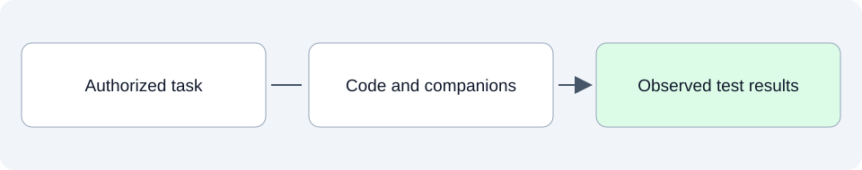

# Build and test: implement and demonstrate

This folder will record what a scoped implementation changed and what its tests actually demonstrate. It connects code changes to the intended behavior and identifies remaining defects or limitations.

## SpeakerCoach today

The project has an existing browser prototype, but this stage currently contains no build-and-test report. There is no active application sprint, so this documentation update does not start implementation.

## What belongs here as we develop

A useful report names the changed behavior, links the source and its human-readable companions, describes meaningful checks and separates passed tests from behavior still needing browser or user validation.

## Explore

- [Detailed design](../08-low-level-design/README.md) describes contracts; [Planning](../07-planning/README.md) identifies selected work; [Evaluation](../04-benchmarks-and-eval-strategy/README.md) defines useful evidence.

Read files in order: **01 Intended**, **02 Current**, **03 Planned**. Additional topics use dotted numbers such as `01.1` or `03.2`; release and sprint plans identify their horizon in the filename and text.
See the [folder guide](../../../asdg/00-governance/docs/stage-layout.md) for consolidation at cycle closeout. Return to [project documentation](../README.md).
