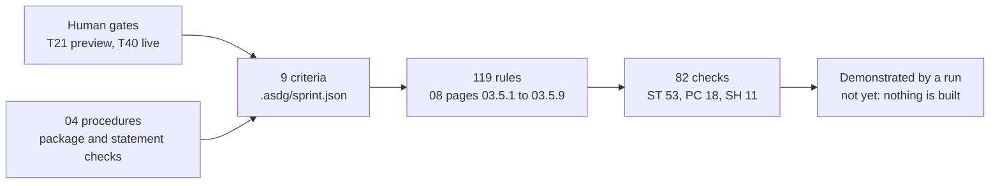

# SPRINT-003 specification review: does it prove the nine criteria?

Alice (Alice.Good.Meetings) is built for one reader, Pablo, who glances at it while he answers an interview question. SPRINT-003 adds a new page and a proposed answer. This review asks one question of Detailed Design's specification and test map: for each of the nine sprint criteria, is there a rule and a check that would demonstrate it?

*Criteria 1, 2 and 7 also rest on Pablo's own judgment; criterion 9 rests partly on 04's reviewer-run procedures, which the test map does not yet link.*

## Verdict: CHANGE_REQUIRED

Every criterion can be satisfied by what is specified, and no rule lacks a check or the reverse. Six small text changes (F1 to F6) are needed before 00 Governance records READY_FOR_09, and Pablo must settle one status conflict (F9) besides his open review items. See [findings](03.1.3-sprint-003-review-findings.md).

## The nine criteria at a glance

Rule and check IDs are on the 08 pages. "Partial" means the rule or check is missing or sits outside 08.

| # | Criterion in short | Rules | Checks | Result |
| --- | --- | --- | --- | --- |
| 1 | Pablo approves the layout from a preview first | PV-1 to PV-5 | ST-53, PC-17, PC-18 | Partial: no rule for approval before change (F2) |
| 2 | Cue, Focus, Live, bullets readable; details never move them | PG-2 to PG-7, PG-14 | PC-03 to PC-05 | Covered; sizes provisional until T22 |
| 3 | Answer on Confirm, replaced on any change, one call | RS-2, RQ-8, CT-3 to CT-6, CT-11 | ST-06 to ST-08, ST-13 to ST-15, ST-19 | Covered |
| 4 | No key: page, timer, cue work; clear message | HL-1 to HL-6, NK-1 to NK-8, LB-6 | ST-32 to ST-38, PC-08 to PC-10 | Covered |
| 5 | Tests pass; page check for all seven states | ST-01 to ST-53, PC-01 to PC-11 | same | Covered; needs an installed browser |
| 6 | `alice-run.sh` starts or reuses | RN-1 to RN-14 | SH-1 to SH-11 | Covered; two clauses unchecked (F5) |
| 7 | One live session, pass or fail by his rule | TM-1 to TM-8, plus 04's script | ST-44 to ST-46 | Partial: a human act, specified by 04 (F4) |
| 8 | Details area from the same call, scrolls inside itself | RS-1, RS-3, PG-4 to PG-6 | ST-07, ST-09, PC-04, PC-05 | Covered; height provisional |
| 9 | Package-only context, general without it, statements match | RQ-1 to RQ-7, PK-1 to PK-10 | ST-01 to ST-05, ST-25 to ST-31 | Partial: 04's checks unlinked (F1) |

## Evidence and limits

Read on 18 November 2026: `.asdg/sprint.json` (SHA-256 `90d6dab6…5d69131`, as given), specification 03.5 (`4499da47…c1bc117`), test map 03.6 (`75b1f42b…28f46bd`), the OpenSpec change and the cited stage pages. I recomputed the 119-rule and 82-check coverage from the tables; it matches [03.6.5](../08-low-level-design/03.6.5-s003-coverage-by-rule.md). Nothing was built or run; no package text was read; no approval is recorded.

Details: [criteria 1 to 5](03.1.1-sprint-003-review-criteria-1-to-5.md) · [criteria 6 to 9](03.1.2-sprint-003-review-criteria-6-to-9.md) · [findings and unselected work](03.1.3-sprint-003-review-findings.md) · [folder index](README.md)
