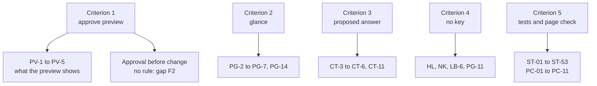

# SPRINT-003 specification review: criteria 1 to 5

This page traces the first five sprint criteria to the 08 [specification](../08-low-level-design/03.5-sprint-003-specification.md) and [test map](../08-low-level-design/03.6-sprint-003-test-map.md). It belongs to the [review](03.1-sprint-003-specification-review.md). "Provisional" means a limit that T22 fixes after Pablo approves the preview.

*Each rule group has checks; "approval before change" under criterion 1 is the one missing rule.*

## Criterion 1: Pablo approves the layout from a preview

- **Rules:** PV-1 (static files at `/preview`), PV-2 (no network, key, package), PV-3 (all states, both sizes), PV-4 (address fragments), PV-5 (control placement).
- **Checks:** ST-53 (PV-1, PV-2), PC-17 (PV-3 to PV-5), PC-18 (PV-2).
- **Gap F2:** nothing states that `index.html` stays unchanged until a dated approval by hash exists. The page says only "Approval is by file hash (T21)". The plan and [tasks 4.1](../../../openspec/changes/sprint-003-proposed-answer/tasks.md) do not name T21 as a precondition of the page build.

## Criterion 2: glance

- **Rules:** PG-2 (four elements visible and unclipped at 1280 × 900, with the longest content), PG-3 (no smaller than at `7d60c0f`), PG-4 (details scroll inside themselves; the four keep position and size), PG-5, PG-6, PG-7, PG-14.
- **Checks:** PC-03, PC-04, PC-05; Pablo's own part is judged in the preview and live session, as the test map says.
- **Note F6:** PG-4 compares shortest and longest content, but only PC-04 and PC-05 are listed for it. PG-3's baseline sizes are "recorded by T28", the builder's task; record them before the build.

## Criterion 3: proposed answer

- **Rules:** RS-2 (one to three single-line bullets), RS-1 and RQ-8 (one call per attempt, two fields), CT-3 and CT-4 (Confirm replaces both in one update), CT-5, CT-6 (late results dropped), CT-11 (no write path to Focus), PG-7, PG-9.
- **Checks:** ST-06 to ST-08, ST-13 to ST-15, ST-19, PC-04, PC-13.
- **Verified in code:** `confirm()` in `poc/session.mjs` is the only writer of Focus and refuses identical text, so "every Confirm raises the version" (CT-4) covers every Focus change.
- **Wording:** with the decided retry, one answer can cost two calls. RQ-8 says "one call per attempt", which is accurate; the criterion's "one model call" is read the same way.

## Criterion 4: no key

- **Rules:** HL-1 to HL-6, NK-1, NK-2, NK-4 to NK-8, LB-6, PG-11, with NK-3 for a rejected key.
- **Checks:** ST-32 to ST-38, ST-24, PC-08 to PC-10, PC-12. PC-08 is the case that must also show the timer and cue working (NK-5).
- **Note:** NK-3 shows Unavailable only after Start (item R2). Criterion 4 speaks of a missing key, so it is unaffected; 04's plan wording is.

## Criterion 5: tests and the scripted page check

- **Rules and checks:** ST-01 to ST-53 and FX-1 to FX-5 (ST-49 to ST-52) make every state reachable without OpenAI.
- **Seven states:** Empty PC-01, Preparing PC-02, Shown PC-03 to PC-05, General PC-06, Failed PC-07, Unavailable PC-08 to PC-10, Last known PC-11.
- **Verified:** `poc/poc.test.mjs` holds 19 test cases today, as the map says. The page check needs an installed browser.
