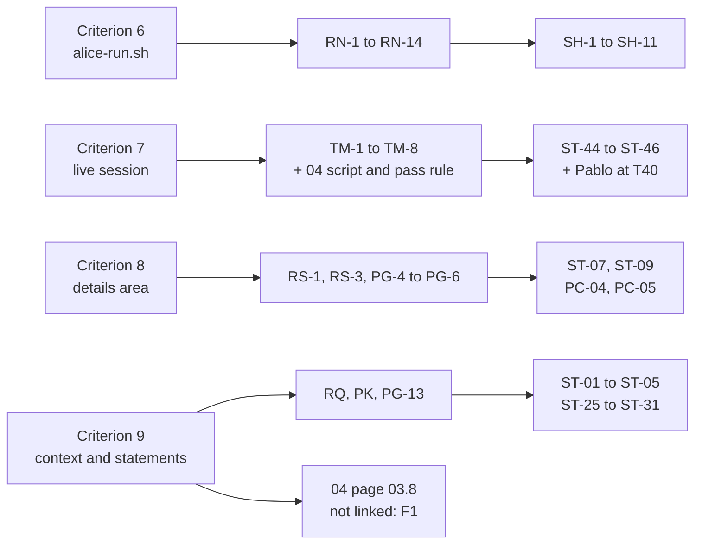

# SPRINT-003 specification review: criteria 6 to 9

This page traces criteria 6 to 9 to the 08 [specification](../08-low-level-design/03.5-sprint-003-specification.md) and [test map](../08-low-level-design/03.6-sprint-003-test-map.md). It belongs to the [review](03.1-sprint-003-specification-review.md).

*Criterion 7 is a human act; criterion 9 needs 04's reviewer-run procedures to be complete.*

## Criterion 6: `bash poc/alice-run.sh`

- **Rules:** RN-5 (start when nothing answers), RN-7 (reuse a current service), RN-6 (refuse another program), RN-10 and RN-11 (start without a key file, report ready after `/health`), RN-12 (never print the key).
- **Checks:** SH-1 (start), SH-3 (reuse), SH-2, SH-4, SH-7, SH-10.
- **Gap F5:** RN-9 ("if it will not end, exit 3"), the 2-second probe limit of RN-4 and RN-11's "service exits first" have no step. Only the successful paths are checked.

## Criterion 7: one live session

- **Specified elsewhere:** the seven-step script, the pass rule Pablo decided on 18 November, and the package check are in 04's [live session](../04-benchmarks-and-eval-strategy/03.6.1-sprint-003-live-session.md). 08 supplies instrumentation only: TM-1 to TM-8 and the audit events, checked by ST-44 to ST-46.
- **Steps backed by rules:** step 5 and step 6 by CT-4 and CT-6 (ST-14, ST-15); step 2 by CT-10 (ST-18); step 7 by CT-13 (ST-21).
- **Gap F4:** step 7 expects "both marked last known". The Focus question's mark exists already (UC-04 rule 4 in [03.2](../08-low-level-design/03.2-uc-04-state-and-rules.md)), but PC-11 asserts only the answer card.
- **Limit:** TM-5 takes speech start from any voice, so an interviewer still talking can hide whether bullets were visible before Pablo spoke (item R5).

## Criterion 8: details area

- **Rules:** RS-1 (bullets and details from one call, separate fields), RS-3 (details limit, required with documents), CT-8 (published together), LB-3, PG-4 (scroll inside only), PG-5 (no collapse control), PG-6 (no animation or sound).
- **Checks:** ST-07, ST-09, ST-17, PC-04, PC-05. The details height and `DETAILS_MAX` stay provisional until T22.

## Criterion 9: context and data statements

- **Rules:** PK-1, PK-2, PK-5 (folder, file types, 20,000 limit), RQ-1, RQ-4, RQ-5 (what is sent), RQ-6 (general points without documents), PK-10 and PG-13 (text stays out of page and logs), LB-4 and LB-9 (General says so).
- **Checks:** ST-01 to ST-05, ST-16, ST-25 to ST-31, PC-06, PC-16.
- **Gap F1:** "never holds benchmark material" and "statements match" are not 08 rules. 04's [package and statement checks](../04-benchmarks-and-eval-strategy/03.8-sprint-003-package-and-statement-checks.md) now exist, but the test map still says 04 "names them once T13 is written", and it links neither. Step 3 of that page proposes a static 08 check, that no `poc/` source names `eval-data`, which is not yet a rule.
- **Gap F9:** 03.5.10 lists criterion 9's "only" reading (T02) as decided; 04's page 03.8 says T02 "may narrow it". I found no recorded yes.
