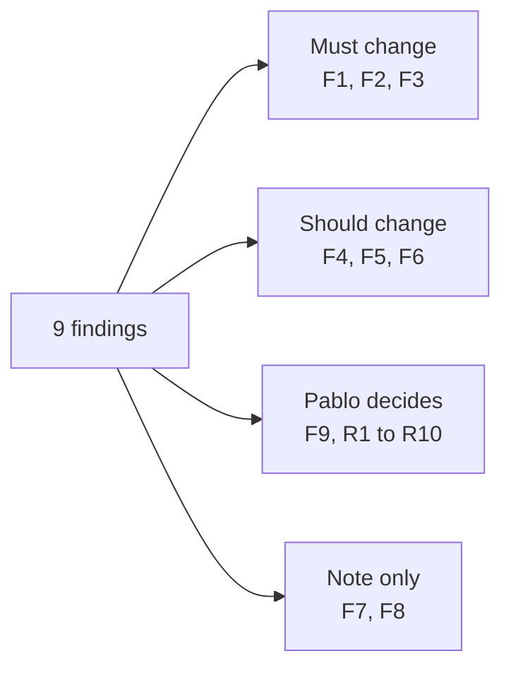

# SPRINT-003 specification review: findings and unselected work

These are the findings behind the verdict CHANGE_REQUIRED in the [review](03.1-sprint-003-specification-review.md). IDs F1 to F9 are used on the [criteria 1 to 5](03.1.1-sprint-003-review-criteria-1-to-5.md) and [criteria 6 to 9](03.1.2-sprint-003-review-criteria-6-to-9.md) pages. "Owner" is who would change the text; I changed nothing.

*Contradictions with decided items: none found. One status conflict (F9) concerns T02.*

## Findings

| ID | Finding | Rule or check | Owner and proposed change |
| --- | --- | --- | --- |
| F1 | Criterion 9's benchmark and statement checks are not linked from the test map, and the "live code never reads `eval-data`" check is a proposal, not a rule. `eval-tools/` is outside the sprint scope. | PK-10; 03.8 | 08: link 03.8, add a rule and a check. Pablo or 00: allow `eval-tools/`. |
| F2 | No rule says the page stays unchanged until Pablo's dated approval by hash. | PV-1 to PV-5 | 08: add a rule and a precondition on task 4.1. |
| F3 | A Last known General answer may lose its General tag, and Failed has no "content kept". | CT-13, LB-7 | 08: say the tag and reason persist beside "Last known, not live". |
| F4 | Live step 7 expects the Focus question marked last known; PC-11 asserts only the answer card. | LB-7, PC-11 | 08: add the Focus mark to PC-11. |
| F5 | Unchecked clauses: RN-9 "will not end", RN-4's 2-second limit, RN-11 "exits first". PG-14 is asserted only in PC-04. | RN-4, RN-9, RN-11, PG-14 | 08: add steps, or assert PG-14 in each state. |
| F6 | One case carries many rules: PC-04 seven, ST-44 five, PC-08 four. The map says a failing case should point to one rule. PG-3's baseline is recorded by the builder. | PC-04, ST-44, PC-08 | 08: split the cases or name the assertion per rule. |
| F7 | Bullet and details limits, wording and control placement are provisional. Criteria 2, 3 and 8 cannot be proved at fixed numbers until T22. | RS-2, RS-3, LB-*, PV-5 | Expected; 08 at T22. |
| F8 | Everything is unbuilt, so no check has run. Gate: `check-implementation` is blocked by two modified skill integrations (03.5.10). | all | Governance, before T20. |
| F9 | T02 is "decided" on 03.5.10 but "may narrow" on 03.8. If undecided, RQ-5 (instructions are also sent) differs from the criterion's literal "only". | RQ-5, criterion 9 | Pablo, via 00: record yes or a changed reading. |

## Unselected work

Everything traces to a decision or an evaluation-plan commitment, but these rules go beyond the criterion text:

- **TM-1 to TM-8** (ST-44 to ST-46): answer delay; criterion 7's pass rule excludes delay. Supports the decided "learn it in the live session".
- **PR-1 to PR-4** (ST-47, ST-48): the print option, accepted by Pablo as droppable.
- **RN-3, RN-8, RN-9, RN-13, RN-14:** reading `PORT` from the key file and ending an older idle service. Criterion 6 says only start or reuse; item R6 awaits Pablo.
- **NK-3** (PC-10): a rejected key, from 04's three-case plan, not from "no key".
- **PG-12:** literal markup; hardening.

## What Pablo must still decide

Items R1 to R10 on [03.5.10](../08-low-level-design/03.5.10-s003-review-items.md) are all open. R6 and R5 matter most for criteria 6 and 7.
