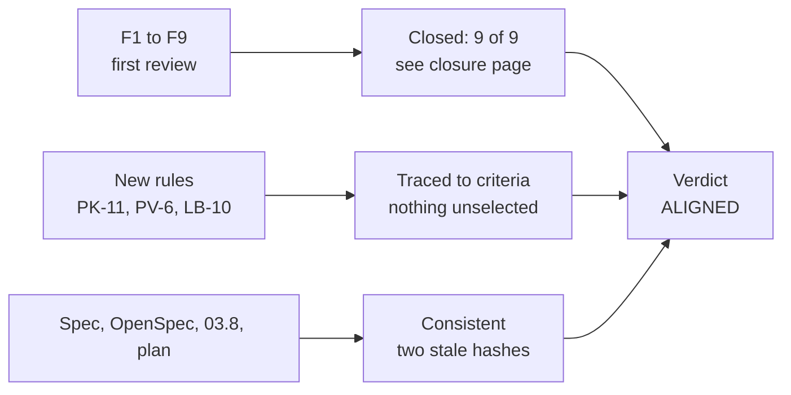

# SPRINT-003 specification recheck: ALIGNED with the nine criteria

Alice (Alice.Good.Meetings) shows Pablo a proposed answer while he glances at the page in an interview. Detailed Design revised its specification after the [first review](03.1-sprint-003-specification-review.md), whose bytes are unchanged. This update rechecks the revised 08 pages and test map against that review's findings F1 to F9 and the nine sprint criteria in `.asdg/sprint.json` (unchanged, SHA-256 `90d6dab6…5d69131`).

*Every earlier finding is closed in the text; two housekeeping items remain and block nothing.*

## Verdict: ALIGNED

Each of the nine criteria has a rule and a check that would demonstrate it, as far as a specification can: criteria 1, 2 and 7 still end in Pablo's own judgment, which no check replaces. Decisions relied on are now recorded as decided, with no contradiction found. This is a document review only: nothing is built, no check has run, and no page hash below carries any approval.

## Recomputed coverage

I recounted from the tables of 03.5.1 to 03.5.9 and 03.6.1 to 03.6.4, not from the coverage page.

| Measure | Result |
| --- | --- |
| Rules | 122 in 14 groups, matching the specification index |
| Checks | 99: ST 57, PC 27, SH 15, matching the test map |
| Rules without a check | none |
| Checks citing an unknown rule, or no rule | none |
| Forward and reverse tables ([03.6.5](../08-low-level-design/03.6.5-s003-coverage-by-rule.md)) | identical for every rule |
| Checks carrying four or more rules | none (first review: PC-04, ST-44, PC-08) |

## Where the rest is

- [Closure of F1 to F9 and the new rules](03.2.1-sprint-003-recheck-closure.md)
- [Consistency with 03.8, the plan and the OpenSpec change, and what remains](03.2.2-sprint-003-recheck-remaining.md)
- Return to the [first review](03.1-sprint-003-specification-review.md) or the [folder index](README.md).

## Evidence and limits

Read on 18 November 2026 after Governance relayed Pablo's "Accept all": R1 to R10 accepted, criterion 9's "only" meaning the answer request alone (T02), and the reviewer script at `poc/review/package-check.mjs`. I saw the decision only as relayed, in 03.5.10, 03.8 and the plan. I ran `sprint check-implementation` for `poc/server.mjs`: it still reports IMPLEMENTATION BLOCKED over the `asdg-pre-code-review` integration.
