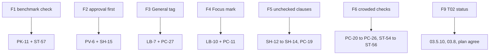

# SPRINT-003 recheck: closure of the earlier findings

This page belongs to the [recheck](03.2-sprint-003-specification-recheck.md). It takes each finding of the [first review](03.1.3-sprint-003-review-findings.md) and says what the revised [specification](../08-low-level-design/03.5-sprint-003-specification.md) and [test map](../08-low-level-design/03.6-sprint-003-test-map.md) now hold.

*Each earlier gap now has its own rule or check.*

## Closure table

| ID | Result | Evidence |
| --- | --- | --- |
| F1 | Closed | The test map links 03.8. PK-11 forbids any `poc/` source outside `poc/review/` from naming `eval-data/` or importing the script, and ST-57 checks it. The script location is decided; 03.8 and the OpenSpec change use it. |
| F2 | Closed | PV-6: `index.html` stays unchanged until a dated approval names the preview files by SHA-256 and the hashes equal the current bytes. SH-15 checks it. Tasks 4.1 now states T21 and task 1.3 as preconditions. |
| F3 | Closed | LB-7 keeps a General answer's tag and reason line and a Failed answer's note beside "Last known, not live". PC-27 checks it. |
| F4 | Closed | LB-10: the Focus question keeps its own last-known mark. PC-11 now covers LB-7 and LB-10. |
| F5 | Closed | SH-12 (RN-9, will not end), SH-13 (RN-4, 2-second probe), SH-14 (RN-11, exits first). PC-19 asserts PG-14 once per state, in each of the seven. |
| F6 | Closed | PG-3 to PG-7 each have a page-check case (PC-20 to PC-24). ST-44 now covers TM-1 and TM-2 alone, with ST-54 to ST-56 for TM-3 to TM-5. PG-3's baseline is recorded before the build by a reviewer other than the builder. |
| F7 | Open by design | Bullet and details limits, wording and placement stay provisional until T21 and T22. |
| F8 | Open | `check-implementation` is still blocked by a skill integration; Governance must repair it before T20. |
| F9 | Closed | 03.5.10, 03.8 and the plan record criterion 9's "only" as the answer request alone, decided on 18 November. |

## The new rules against the criteria

- **PK-11 and ST-57** serve criterion 9, "the package never holds benchmark recordings": they stop live code from reading the benchmark. They add no behavior for Pablo.
- **PV-6 and SH-15** serve criterion 1, approval before the page replaces the current one.
- **LB-10** serves criterion 7's step 7 and UC-04's existing rule.
- **LB-7's extension** serves criterion 9's "say so".
- The reviewer script `poc/review/package-check.mjs` (task 7.4) is new code, but it is the procedure 03.8 requires for criterion 9; it is not shipped behavior.

I find no rule that is unselected work. The first review's list (TM, PR, RN-8 and RN-9, NK-3, PG-12) stands, each tied to a decision Pablo has now accepted.
