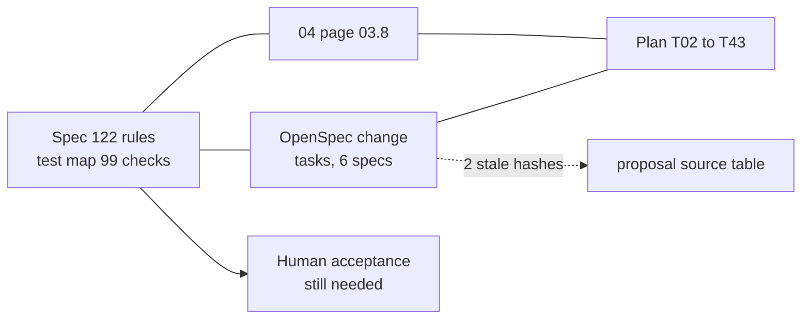

# SPRINT-003 recheck: consistency and what remains

This page belongs to the [recheck](03.2-sprint-003-specification-recheck.md). It compares the specification and the OpenSpec change `sprint-003-proposed-answer` with 04's [package and statement checks](../04-benchmarks-and-eval-strategy/03.8-sprint-003-package-and-statement-checks.md) and the Stage 07 [plan](../07-planning/03.9-sprint-003-plan.md), then lists what is left.

*The four documents agree; the dotted line is the one place they drift.*

## Consistent

- **Script and scope:** `poc/review/package-check.mjs` appears in PK-11, 03.8, task 7.4 and the answer-package spec; no `eval-tools` reference remains outside my first review.
- **T02:** decided in 03.5.10, 03.8 and the plan; RQ-5 and the statement check follow it.
- **R3 and R7:** 04's plan now says the service refuses an over-limit result, as RS-4 does. The statement check allows exactly what RQ-5 sends.
- **Tasks and checks:** every rule group has a task, and 03.6's ST, PC and SH ranges match the task lines (ST-01 to ST-57, PC-01 to PC-27, SH-1 to SH-15).
- **Preview gate:** task 4.1 names T21 and task 1.3 as preconditions, as the plan requires.

## Housekeeping, none blocking

1. **Stale hashes (08):** the proposal's source table lists the 04 evaluation plan as `ab96d2b8…` (now `f81510a1…`) and page 03.8 as `2c7ba622…` (now `32c80802…`). Ten other rows match. The proposal itself says to recheck before apply.
2. **SH-15 placement (08):** it is a reviewer gate on `index.html`, but sits among the shell checks of `alice-run.sh`. A failure would blur criterion 6's result; label it a separate gate.
3. **03.8 wording (04):** item 3 still says "Proposed for 08"; PK-11 now exists.
4. **Task wording (08):** task 2.1 says "per PK-1 to PK-10" yet verifies ST-57; PK-11 is named only in 7.4.

## Still needed, none by an agent

- **Pablo:** the recorded T14 outcome on the specification, since "Accept all" reached me as a relay; T21, his approval of the preview by hash; T40, the live session and its pass or fail.
- **00 Governance:** record `READY_FOR_09` once T14 is recorded, and repair the `asdg-pre-code-review` integration so implementation checks can pass.
- **Pre-build:** record the PG-3 baseline sizes (task 1.3, proposed for 10 ReviewQA; not yet assigned), and fix the provisional limits (T22).

The hashes of these pages and of the first review record AI work only; they carry no approval and grant none.
