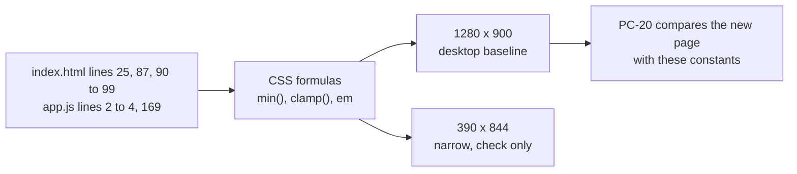

# SPRINT-003 baseline: the text sizes the new page must not shrink below

Pablo reads Alice (Alice.Good.Meetings) at a glance from a second screen, so rule PG-3 says the cue word, Focus and Live text on the new page are "no smaller than on the page at revision `7d60c0f`". This page records those sizes from the source, so the builder (09) does not record its own baseline. It serves task T19 of the Stage 07 plan and the check PC-20.

*Sizes are computed from the source; nothing was run or measured in a browser.*

## Method and assumptions

At `7d60c0f` both files are byte-identical to the working tree: `index.html` SHA-256 `c8f1bce5…ba98f` and `app.js` `eebe55b4…78f28`, and `git diff 7d60c0f` on them is empty. I read them without running the page. One `vmin` is 1% of the smaller viewport side; `rem` is 16px because no root font size is set (`index.html` lines 8 to 13). Browser minimum font settings and zoom are not considered.

## Baseline sizes in CSS pixels

Rows 1, 3 and 4 are the elements PG-3 names. The others are text the layout also should not shrink below; I propose them, and Governance or Pablo may narrow the list.

| # | Text | Rule in source | At 1280 × 900 | At 390 × 844 |
| --- | --- | --- | --- | --- |
| 1 | Cue word (GOOD, LAND IT, STOP), bold | `index.html:25` `min(8rem, 20vw, 20vh)`; words `app.js:2-4`, applied `app.js:169-170`; start text `index.html:110` | 128 | 78 |
| 2 | Question panel base | `index.html:87` `clamp(14px, 2.2vmin, 20px)` | 19.8 | 14 |
| 3 | Focus question text, bold | inherits row 2; `index.html:94` | 19.8 | 14 |
| 4 | Live question text, italic | inherits row 2; `index.html:96` | 19.8 | 14 |
| 5 | Labels "Focus question", "Live question" and their status tags | `index.html:91`, `:93` `0.75em` | 14.85 | 10.5 |
| 6 | Live note, feedback line, confirm hint | `index.html:97` `0.85em` | 16.83 | 11.9 |
| 7 | Confirm question, Clear live buttons | `index.html:99` `0.85em` of row 2 | 16.83 | 11.9 |
| 8 | Start Listening, Good, Land it, Stop buttons | `index.html:42` `min(11px, 2vmin)` | 11 | 7.8 |
| 9 | Server readout (diagnostic) | `index.html:74` `clamp(12px, 1.8vmin, 17px)` | 16.2 | 12 |
| 10 | Debug readout (diagnostic) | `index.html:58` `min(24px, 2.5vmin)`; text `app.js:186` | 22.5 | 9.75 |

## Reading the table

- The phone-width rule at `index.html:103-106` moves the panels but changes no font size. Only 1280 × 900 is the glance baseline in PG-3; the 390 × 844 column is for completeness.
- The page has no bullet card or details area yet, so those have no baseline; their sizes come from the approved preview.
- Rows 9 and 10 are not glance elements, and the new layout may move or drop them. If kept, the same floors apply.
- PC-20 should read the computed font size of each element in the old page's rules, not these rounded figures, and report a difference as a fail of this record, not of the new page.

Return to the [folder index](README.md) or the [recheck](03.2-sprint-003-specification-recheck.md).
