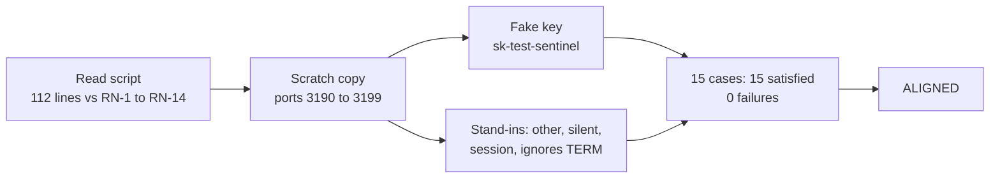

# SPRINT-003 review of `poc/alice-run.sh` (T30): ALIGNED

Pablo wants one command that gets Alice (Alice.Good.Meetings) ready without interrupting a session or printing the key. 09 Coding wrote `poc/alice-run.sh`; this page reads it against rules RN-1 to RN-14 of 08's [run-script contract](../08-low-level-design/03.5.9-s003-run-script.md) and re-runs the shell cases of the [shell checks](../08-low-level-design/03.6.4-s003-shell-checks.md) myself.

*Every case ran in a scratch copy; the service on port 3000 was never touched.*

## Verdict: ALIGNED

The script satisfies every rule I could test, and I found no failure. Hashes read: `alice-run.sh` `6e8ef947…` and `alice-run.md` `61940df2…`, both as 09 reported. This is a review of AI work: no page hash here carries any approval.

## Results by shell case

| Case | By reading | My run (exit, evidence) | Result |
| --- | --- | --- | --- |
| SH-1 | RN-5, 10, 11 | 0; "ready" printed after `/health` answered; Ctrl+C ended it with 0 and freed the port | Satisfied |
| SH-2 | RN-4, 6 | 2; port named; the other program still running | Satisfied |
| SH-3 | RN-7 | 0; address printed; one listener only | Satisfied |
| SH-4 | RN-10 | 0; message names the missing key; health `configured: false` | Satisfied |
| SH-5 | RN-8, 9 | stand-in idle service ended; new real service started, later `startedAt` | Satisfied |
| SH-6 | RN-9 | 0; "restart is pending"; session stand-in still running | Satisfied, see limit 1 |
| SH-7 | RN-12 | two full runs, one with the key also in the environment: no sentinel in output | Satisfied |
| SH-8 | RN-2 | 1 with a message, with `PATH`, `HOME` and `ALICE_GOOD_MEETINGS_NODE` all set to find no Node | Satisfied |
| SH-9 | RN-1, 3 | argument: 64 with usage; ports 0, 70000, abc: 64 | Satisfied |
| SH-10 | RN-11 | 3 after 30 s; stub stopped, none left | Satisfied |
| SH-11 | RN-13, 14 | scan: only `127.0.0.1`; service saw `ALICE_PRINT_REQUEST=1` unchanged | Satisfied |
| SH-12 | RN-9 | 3 after 5.8 s; message; nothing started | Satisfied |
| SH-13 | RN-4 | 2 after 2.1 s; silent listener untouched | Satisfied |
| SH-14 | RN-11 | 3; "exited before it answered"; no ready line | Satisfied |
| SH-15 | PV-6 | gate run, see below | Satisfied |

## SH-15, the gate

The three preview files hash to the values in the [approval record](../00-governance/03-sprint-003-preview-approval.md) (`24ee034e…`, `f493b9a4…`, `d20f82cb…`). The approval is dated 14:09 local on 18 November; `index.html` last changed at 14:31 and `app.js` at 14:32, so the build began after it. At the start of this session neither file was modified against `HEAD`.

## RN-12, RN-9 and killing the wrong program

- **RN-12:** the script prints only fixed messages and the address. It reads `.env.local` only for its `PORT=` line, and a bad value is never echoed. It never sources the file; the key reaches only the service through `--env-file`.
- **RN-9:** the stop path runs only after `/health` proves Alice, older and with 0 sessions. The script ends whatever listens on that port, waits 5 seconds and exits 3 if it stays up, or if no listener is found.
- **Unrelated program:** none was ended in any run. Reading finds two small risks, both unlikely: `lsof` matches that port on any address, not only `127.0.0.1`, and a session could start between the probe and the stop.

## Limits and notes

1. SH-6 used a stand-in that reports one session, not a live browser session; the script reads only `sessions`.
2. `/health` time is `Date.now()` in milliseconds, matching the file times the script compares; RN-8's file list matches what the service imports.
3. Suggested, not blocking: limit `lsof` to `-iTCP@127.0.0.1:PORT`. Nothing was edited and no receipt was written.
