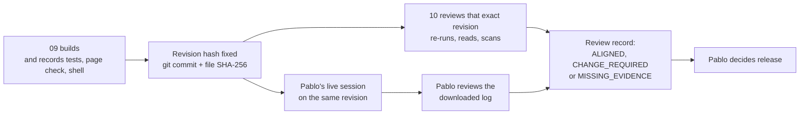

# SPRINT-004 review plan: how 10 ReviewQA will review the built revision

Pablo wants to load his package from the page, keep a complete local log of each meeting and work from a new screen. Before coding starts, 00 Governance asked for my plan to review that work independently. This is a plan only: I have reviewed no unbuilt code, approved nothing, edited no code or sprint record, and SPRINT-004 is still a proposal with no sprint active. Draft of 19 November 2026; it rests on plan v6, 04's checks, and 08's specification and test map, all drafts.

*I review one fixed revision; anything built after it needs a new review.*

## What I review, in order

1. **Revision.** 09 names one commit and the SHA-256 of `index.html`, `app.js` and every changed `poc/` file. I re-hash them before and after my work; a difference voids the review.
2. **Tests, page check, shell, kept apart.** I re-run `node --test poc/poc.test.mjs`, the page check (PC4-01 to PC4-48) and the shell checks myself, in a scratch copy with invented files and a fake key, never on port 3000 and never with real package text. I compare my counts with 09's report.
3. **Upload hardening.** I attempt each refusal on scratch ports, not only read the tests: wrong Host or Origin, a non-JSON content type, one byte over 200 KB, 21 files, unsafe names, dotfiles, non-UTF-8, 20,001 characters, an upload while listening. Each must keep the old package and leave no package text on disk, in the log or in output (a canary scan).
4. **Run script.** `bash poc/alice-run.sh` is re-run as in T30; its result is recorded apart from the others.
5. **Statements.** I run 04's statement check on the root `AGENTS.md` and `poc/README.md`, and count 50 nonblank lines.
6. **Live session and log.** I do not run the live session; I check that its record names the same revision, then review the log by counts and event types only.

## Where the rest is

- [Commitments, checks and evidence](03.5.1-sprint-004-review-coverage.md)
- [Review, Pablo's decisions, and what blocks release](03.5.2-sprint-004-review-decisions-and-blocks.md)
- [The avatar story: vendored files, failure and write path](03.5.3-sprint-004-review-avatar.md)

Return to the [folder index](README.md).
