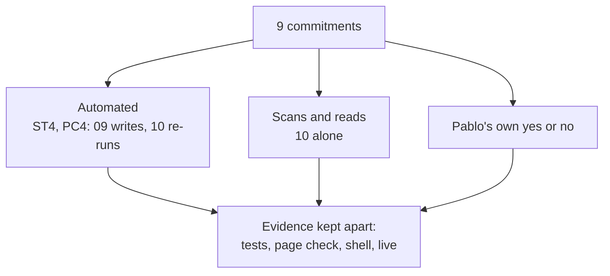

# SPRINT-004 review plan: commitments, checks and evidence

This page belongs to the [review plan](03.5-sprint-004-review-plan.md). It says, for each commitment of plan v6, which checks carry it, what I run myself and what evidence I need before I can say ALIGNED. Check IDs come from 08's [test map](../08-low-level-design/03.8-sprint-004-test-map.md) and 04's [checks](../04-benchmarks-and-eval-strategy/03.10-sprint-004-upload-log-and-screen-checks.md).

*Where two checks overlap I count one result, and I name any commitment that no check carries.*

## Commitment table

| Commitment | Checks | I run or read | Evidence I need |
| --- | --- | --- | --- |
| S004-STATUS | ST4-01, PC4-17, 23, 40 | Reload the page, call `GET /package` | A package line and a response with counts and no text |
| S004-UPLOAD | ST4-02 to 07, 29, 35 to 40; PC4-35 to 39, 45 | The refusals above, then the canary scan | Node test result, page-check result, scan counts |
| S004-LOG | ST4-12 to 28, 30, 34; SH4-1; PC4-42 | Event order, UTC `ms` never decreasing, modes 0700 and 0600, `git status` shows no log, 5 MB cap | Test result, shell record, log counts per event type |
| S004-DOWNLOAD | ST4-08 to 10; PC4-41 | Download from the page; SHA-256 of the copy equals the file | Same hash; mid-session copy is a prefix; foreign Host gets 403 |
| S004-SCREEN | PC4-01 to 26; ST4-11, 31 to 33, 38, 39 | Computed sizes at three window sizes; bold, largest text, columns | Page-check result, then Pablo's yes or no per answer |
| S004-CUE | PC4-27 to 34, 43 to 48; ST4-18 | G, L, S, Esc; 10-second hold with a controllable clock | Page-check result; Space, buttons and speech still work |
| S004-MEETING | PC4-49 (SA-18) | PC4-49 plus I scan page, statements and screen for "interview" used as the only case | Scan list; Purpose lists "review a past meeting" |
| S004-CARRY | none in 08's map; MS-6, ST4-28 partly | Read the request code: package text only in the post-pause request, only terms to transcription | Code read and a request capture with invented text |
| S004-AVATAR (story B-15) | PC4-50 to 59, ST4-43, SH4-3; see [the avatar page](03.5.3-sprint-004-review-avatar.md) | Vendored hashes, blocked-network run, forced failure | Pinned list, request list, page-check result |
| S004-STATEMENTS | SH4-2 (MS-7) | 04's statement check, both ways | Check result and the 50-line count |

## Gaps I will report now

1. **CARRY has no check** in 08's map, which says it is not a screen rule; I will review it by a code read and a request capture, and ask 08 for cases. MEETING is covered by PC4-49 for the page; I add a scan of the statements.
2. **04's page counts "72 checks"**, 08 now holds 90; 04 should be refreshed.
3. **Live-session items** (the log review, bytes per hour) are Pablo's and 04's, not mine; I check that they were recorded.

Return to the [review plan](03.5-sprint-004-review-plan.md).
