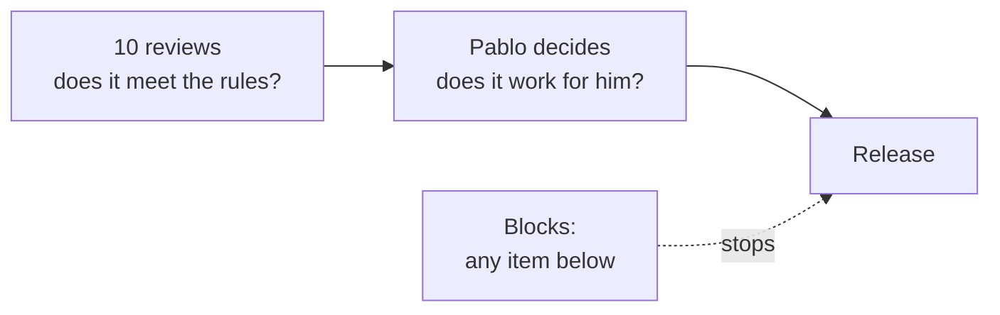

# SPRINT-004 review plan: what is review, what Pablo decides, what blocks release

This page belongs to the [review plan](03.5-sprint-004-review-plan.md). It separates my judgment from Pablo's, and lists the conditions under which I will not say the built revision is ready. It records no approval.

*My verdict says whether the evidence matches the commitments; only Pablo accepts the product.*

## Review (mine) and decisions (Pablo's)

| 10 ReviewQA reviews | Pablo decides |
| --- | --- |
| Rules traced to checks; re-run results match 09's | Whether the live session passes, per 04's decided rule |
| Upload refusals and the canary scan | Each answer yes or no: question largest, two columns, cue named, nothing cut |
| Log structure, order, size, hash of the download | Review of the downloaded log: each `answer_shown` line once for package text |
| Statement check and the 50-line count | Acceptance of the amended documents (owed, not recorded) |
| Request contents (CARRY) and the "meeting" wording | Treatment of other people's speech, deferred to security work |
| Whether any slipped item breaks a never-slip one | Whether to slip the Download button or the screen |

## What blocks release

1. No fixed revision hash, or a changed file after my review began.
2. Any failure or unrecorded result among tests, page check, shell or run script; three results are never merged.
3. A canary or package text found on disk, in a log, in `GET /package` or in output outside the allowed post-pause request.
4. An upload that replaces the package after a refusal, during listening, or is accepted from a foreign Host or Origin.
5. A log that is incomplete, out of order, not Git-ignored, appears in `git status`, or has wrong modes; a download that differs from its file.
6. A statement about what leaves or stays on the Mac that differs from the code, or root `AGENTS.md` over 50 nonblank lines.
7. A live session that is missing, on another revision, or without Pablo's yes or no and his log review.
8. `check-implementation` still blocked by the missing `asdg-pre-code-review` integration, and any SPRINT-003 check not re-run (plan criterion 9).
9. A never-slip item (status, upload, the log file, carry-forward, statements, live session) slipped.
10. The avatar story's own blockers, which remove only that story: see [the avatar page](03.5.3-sprint-004-review-avatar.md).

## Limits

I do not read package text, log text or `poc/context/interview/`; I report counts only. I cannot judge how the screen feels to Pablo. This plan covers none of S004-GUARD, which moved to SPRINT-005.

Return to the [review plan](03.5-sprint-004-review-plan.md).
