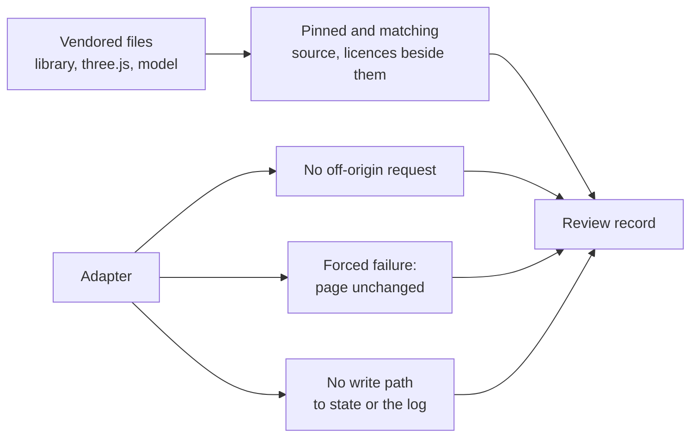

# SPRINT-004 review plan: the avatar story (B-15)

This page belongs to the [review plan](03.5-sprint-004-review-plan.md). The sprint gained a small avatar of Alice in the page, built on the TalkingHead library (MIT, on three.js) and a model file `mpfb.glb` (CC0), per [07](../07-planning/03.14.2-sprint-004-avatar-story.md) and [05](../05-high-level-design-and-architecture/01.11-avatar-adapter.md). The page holds the microphone and the transcript, so vendored code there is a trust risk; I review it as follows once built. Drafts of 19 November 2026. 08 has since written rules AV-1 to AV-8 ([03.7.9](../08-low-level-design/03.7.9-s004-avatar.md)); its checks are PC4-50 to PC4-59, ST4-43 and SH4-3 ([03.8.6](../08-low-level-design/03.8.6-s004-avatar-checks.md)).

*Four independent questions; any failure is CHANGE_REQUIRED for this story alone.*

## What I check, how, and the evidence

| Question | How I check, on the built revision | Evidence I need |
| --- | --- | --- |
| Pinned and matching source (AV-7; SH4-3, ST4-43) | 09 names each vendored file's upstream release tag or commit and its SHA-256. I fetch that release myself into a scratch folder, hash the files and compare byte for byte with the committed ones. | A list of file, version, upstream address, SHA-256; my matching result |
| Nothing unpinned | Search the page, adapter and import map for `http`, `//`, a CDN host or an unpinned version; every module path must resolve inside the project | Search counts, zero hits outside the project |
| Licences beside them | A licence file for the library, three.js and the model next to each; the model's CC0 statement names its source and the 05 note that other example models are non-commercial | The files exist and name the same version |
| No off-origin request (AV-7; PC4-58) | Run the page in a scratch copy with the network blocked, then log every request while the six states run; only `127.0.0.1` on the scratch port is allowed. Also each vendored file must be in the service's fixed asset list and nothing else is served | Request list with zero other hosts |
| Silent failure (AV-6, AV-8; PC4-56, PC4-59) | Force a missing file, a blocked WebGL and a stalled load; the page, cue, timer, bullets, upload and log must pass the page check unchanged, with the avatar box empty or still and no focus or layout change | Page-check result with the failure forced, apart from the normal one |
| No write path (AV-8; PC4-59) | Read the adapter: it gets a frozen copy of state, imports no service or log module and sends no message; a test with a fake library proves the log and state are byte-identical with it on and off | Code read; test result; identical log line counts |

## Also reviewed

- **Cost to the microphone path:** 05 caps the draw at about 15 frames a second, pauses it when the tab is hidden and gives an off switch; I look for each, and for jank reported in Pablo's live session.
- **Never in my judgment:** whether a moving face helps or distracts him, and whether the model file may be committed; those stay with Pablo.

## Blocks release

A vendored file that differs from its pinned source, a missing licence, any off-origin request, a failure that changes the page, or any path from the avatar to state or the log. Because the story slips first and whole, a block here removes the avatar, not the sprint.

Return to the [review plan](03.5-sprint-004-review-plan.md).
