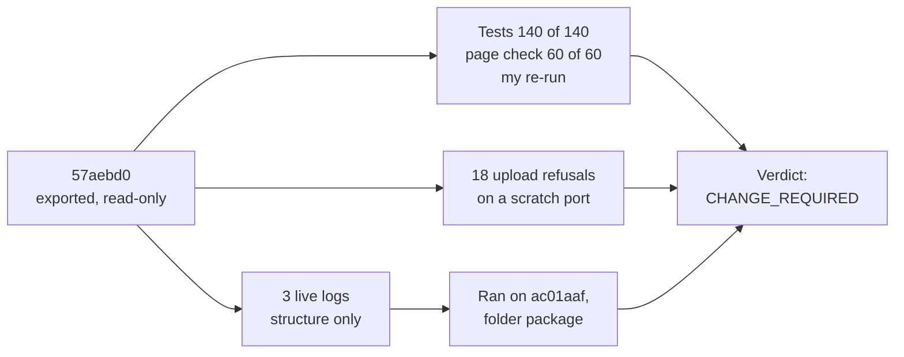

# SPRINT-004 review record: revision 57aebd0

Alice (Alice.Good.Meetings) now lets Pablo load a package from the page, keeps a local meeting log, shows a new screen and a small avatar. Criterion 10 asks 10 ReviewQA to review the exact revision `57aebd0` (branch `sprint-04`, parent `b55ba40`). I exported that revision with `git archive` into a scratch folder, so no branch, file or commit of the project was touched, and I read no package text and no log text.

*The code is sound; the live evidence and two statements are not yet at this revision.*

## Verdict: CHANGE_REQUIRED, not ready to close

Eight criteria are met or nearly so, but criterion 10 is not met and criterion 9 is not met. Nothing here is an approval; Pablo decides closure.

## Verdict per criterion

| # | Commitment | Verdict | Evidence |
| --- | --- | --- | --- |
| 1 | STATUS | Met | `GET /package` returned counts only, no text; PC4-17, 23, 40 pass |
| 2 | UPLOAD | Met | 18 refusals and 3 acceptances on port 3210, in [03.6.1](03.6.1-sprint-004-review-evidence.md); old package kept after each refusal |
| 3 | LOG | Partly met | Structure, order of `ms`, 0600 files and Git-ignore hold; folder mode 0755 against MS-3; pause lines come late |
| 4 | DOWNLOAD | Met | 404 with no log, 403 for a foreign Origin, ST4-09, 10 and PC4-41 pass; no recorded live download |
| 5 | SCREEN | Partly met | PC4-01 to 26 pass; SA-13's 1.5 ratio is not met for medium questions (open item) |
| 6 | CUE | Met | PC4-27 to 48 pass, including the 10-second hold |
| 7 | MEETING | Partly met | PC4-49 passes; Purpose lists "review a past meeting"; the root statements are not updated |
| 8 | CARRY wording | Met | Code read: `server.mjs` lines 229 to 231 send only terms to transcription; documents go to the post-pause request |
| 9 | STATEMENTS | Not met | Root `AGENTS.md` has no upload or log statement; `poc/README.md` does; my re-runs are recorded here |
| 10 | CARRY live session | Not met | The three logs name revision `ac01aaf`, show `folder` as the package source and were written before this revision existed |
| 11 | AVATAR | Met, one item open | 22 of 22 vendored files match `VENDOR.md`; same origin only; PC4-54 to 59 pass; upstream not compared |

## What blocks closure

1. **Live session on this revision (criterion 10).** Pablo's three sessions ran on 21 November, about 25 hours before `b55ba40` was committed. Their headers say `ac01aaf`, and each shows a three-file folder package, not an uploaded one. I have no record of a downloaded log. A session on `57aebd0` or a later fixed revision, with an uploaded package and a download, is needed.
2. **Root statements (criterion 9).** ASDG Admin owns `AGENTS.md`; the statement check cannot pass until it is updated.
3. **Log folder mode.** The folder is 0755, MS-3 says 0700; either fix it or 08 changes the rule. Pablo said it is fine as is, so this needs a recorded rule change.
4. **Vendored upstream comparison.** Hashes match the pins, but I did not download the upstream release without permission; that comparison is MISSING_EVIDENCE.

Details, my re-runs and smaller findings: [evidence page](03.6.1-sprint-004-review-evidence.md). Return to the [folder index](README.md).
