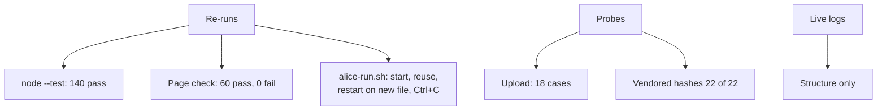

# SPRINT-004 review: evidence, my re-runs and smaller findings

This page belongs to the [review record](03.6-sprint-004-review-record.md) for revision `57aebd0`. All runs used a scratch export, a fake key and invented text on ports 3210 and 3211. No private log text appears here.

*Three result kinds are kept apart: tests, page check and run script.*

## My re-runs

- **Tests:** `node --test poc/poc.test.mjs`: 140 tests, 140 pass, 0 fail.
- **Page check:** `poc/browser-protocol.mjs` in headless Chrome: PC4-01 to PC4-60, all PASS, none FAIL.
- **Run script:** start 0, reuse 0, an older idle service ended when `meeting-log.mjs` was touched (so the new file names are in its list), Ctrl+C 0.

## Upload hardening, probed on a scratch port

| Case | Result |
| --- | --- |
| Wrong Host, foreign Origin, or a PUT with no Origin | 403 |
| Non-JSON content type | 415 |
| One byte over 200 KB | 413 |
| 21 files | 422, `too-many-files` |
| Names `../a.md`, `a/b.md`, `C:x.md`, `a\b.md` | 400 each |
| Dotfile only, or `.pdf` only | 422, `empty` |
| A replacement character | 422, `unreadable` |
| 20,001 characters | 422, `too-large`; 20,000 accepted |
| A refused upload after a good one | old package kept |
| `GET /package`, `GET /log` | no text returned; 404 with no log; foreign Origin 403 |

An invented canary string was found nowhere in the service output or the log folder. Not probed live: an upload while listening and survival across Stop; tests ST4-05 and ST4-06 cover them.

## The three live logs (structure only)

- **Shape:** each starts with `log_started`, ends with `session_stopped`, ends in a newline, has non-decreasing `ms` and times, and holds only the allowed event types and fields. No key pattern appears. Counts per type are consistent: every `answer_shown` follows a `focus_changed`, with three bullets.
- **Revision and package:** `revision` is `ac01aaf` and `package.source` is `folder` in all three (3 files, 18,843 characters). The commits `b55ba40` and `57aebd0` are dated 22 November 01:55 and 02:12.
- **Late `pause` lines:** the line is written when the silence ends, so it comes after the `focus_changed` and `answer_shown` it enabled (one log: question at 12.5 s, pause line at 19.0 s). 04's review step 1 expects transcript, pause, then Focus; that step cannot pass as written. 04 or 08 should state ordering by `startMs`.
- **Package text:** I could not compare bullets with the package, since I may not read it. `answer_shown` bullets can quote it; Pablo's own reading, as 04 decided, covers that.
- **Not exercised live:** a Confirm or Clear control line, an error line, a cue key (the log does not record them), so those rest on tests.

## Smaller findings

- **Vendor:** 22 of 22 files match `VENDOR.md` bytes and SHA-256, none is unlisted, and licence files sit beside them. The library's default Draco URL (`gstatic.com`) is off and the adapter never enables it; the model holds no web address.
- **Same origin:** every `fetch` and `import` in the page resolves to `127.0.0.1`.
- **Audit names:** `package_loaded` writes file names to the console, which conflicts with SU-9 (known, for 08).
- **Port 3000:** no service was listening there when I finished; I started nothing on it.

Return to the [review record](03.6-sprint-004-review-record.md).
