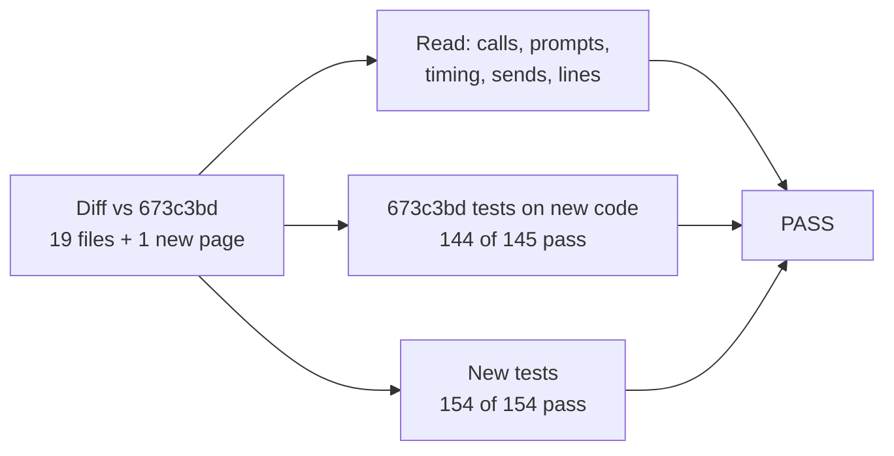

# SPRINT-005 S5-04: the logging change alters no behaviour (PASS)

09's uncommitted change for S5-03 (rules RT5-4, RT5-5, RT5-8 of the [response-time rules](../08-low-level-design/03.11-sprint-005-response-time-rules.md)) adds `model_call` and `question_timing` lines to the meeting log. I read `git diff 673c3bd -- poc/` (19 files changed, `poc/docs/09-measurement-events.md` new) and re-ran the old tests against the new code.

*Scratch copies only; no model call, no browser-smoke, nothing on port 3000, nothing committed.*

## Verdict: PASS

I found no change to what is sent to the model, when it is sent, what goes to the page or the old log lines. This is a review of AI work; no hash here carries any approval.

## What I checked

| Behaviour | Evidence | Result |
| --- | --- | --- |
| Model calls, prompts | `READER_INSTRUCTIONS`, `readerInput`, answer instructions, `maxTokens`, effort `low` untouched (`EFFORT` is the same value, now shared); `Runner` still built once per generator | Unchanged |
| Timing, retries | No new `await`; reader debounce, 30 s limit, answer timeout and one retry untouched; the new calls only read the clock | Unchanged |
| Transcription sends, page | `server.mjs` changes one line (passes `elapsed`); `app.js`, `index.html` and `package.json` have no diff; every `send` is as before | Unchanged |
| Old log lines | Same types and fields; the only difference is order: `model_call` comes before the lines its reading produced (`held`), which is the intended RT5-4 order | Unchanged |
| Faults in the bookkeeping | Session steps are wrapped to drop errors; the answer-area line is in `try`; `usageOf` never throws; `meter` runs before the reply check, so a failed count cannot fail a reading | Safe |
| No text (RT5-4/5) | `callEvent` keeps numbers and fixed words (80 chars at most); `failureReason` gives code words, never the provider message; `question_timing` is numbers and an outcome | Met |
| RT5-8 | Header stays `version` 1; the unknown-type test passes | Met |

## Tests

- **New tree:** 154 of 154 pass.
- **673c3bd's own tests on the new code:** 144 of 145 pass. The one failure lists allowed log types and does not know the two new ones; the new tree's copy of that test adds them.

## Limits

- I did not re-run the page check: the page files and the messages sent to them have no diff. I did not run 09's byte-identical script, which is outside the repository.
- Token counts come from a stub client, not a live call.
- One quirk, not blocking: a stage-time line written at Stop precedes `session_stopped` but follows `answer_dropped`; readers should order by `ms`.
