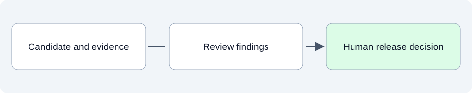

# Review and release: decide what is ready

This folder will explain whether a candidate change is ready to deliver, using its requirements, code, documentation and test evidence. It also records unresolved findings and the human decisions needed.

## SpeakerCoach today

No release-readiness assessment or release decision is documented in this stage yet. A structurally valid ASDG installation does not establish that SpeakerCoach is ready for release.

## What belongs here as we develop

Review includes whether a person can understand the documentation, whether diagrams are accurate and whether source companions match the implementation. Passing tests and a review recommendation inform a release decision; they do not make that decision automatically.

## Explore

- Start with [build and test evidence](../09-build-and-test-cycle/README.md), then consider [operational and user validation](../11-operational-reality-devops-and-user-acceptance/README.md).

Read files in order: **01 Intended**, **02 Current**, **03 Planned**. Additional topics use dotted numbers such as `01.1` or `03.2`; release and sprint plans identify their horizon in the filename and text.
See the [folder guide](../../../asdg/00-governance/docs/stage-layout.md) for consolidation at cycle closeout. Return to [project documentation](../README.md).
