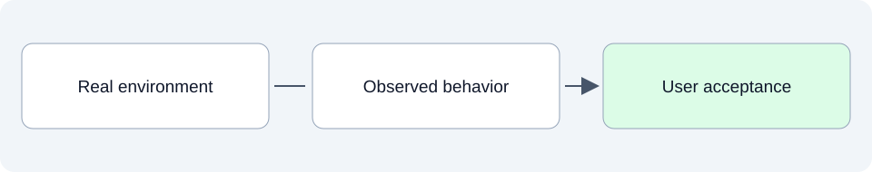

# Real-world operation: does it work for people?

This folder will record how SpeakerCoach behaves in realistic environments and whether users find it useful. It covers delivery, browser and device conditions, recovery from failures and user acceptance.

## SpeakerCoach today

No operational or user-acceptance report is documented in this stage yet. The existing prototype and historical hosting descriptions do not establish a verified deployment or a successful live interview experience.

## What belongs here as we develop

Useful evidence could include microphone permission behavior, quiet speech and background noise, browser compatibility and whether the display distracts the speaker. Technical reliability and the user's assessment of usefulness need separate observations.

## Explore

- Follow the [evaluation strategy](../04-benchmarks-and-eval-strategy/README.md) and feed findings into [release review](../10-document-review-and-release/README.md).

Read files in order: **01 Intended**, **02 Current**, **03 Planned**. Additional topics use dotted numbers such as `01.1` or `03.2`; release and sprint plans identify their horizon in the filename and text.
See the [folder guide](../../../asdg/00-governance/docs/stage-layout.md) for consolidation at cycle closeout. Return to [project documentation](../README.md).
