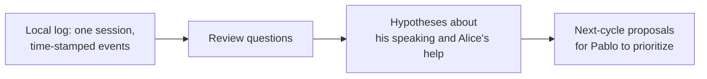

# What the meeting log must let Pablo learn

Owner: 12 Observability. Draft of 19 November 2026, answering 00 Governance for [SPRINT-004](../07-planning/03.14.1-sprint-004-documents-and-decisions.md). Reader: Pablo, reviewing his own speaking and how Alice helped. A proposal; nothing here is approved or built.

*The log is the evidence; every later insight must trace back to an event in it.*

## One line

The log must let Pablo replay a session in order and tell, for each moment, what was said, what question was in force, what Alice showed, and what he did next.

## (1) What the log must contain

| Content | Why it matters later | Resolution |
| --- | --- | --- |
| Session header: session id, start and end (UTC plus local offset), app revision (Git commit), model names and settings, OpenAI configured yes/no, which package/Focus source was loaded by name only | Compare sessions across revisions; explain differences | Per session |
| Every event with one monotonic clock (ms since session start) and a wall-clock time | Order and gaps; align with an audio recording if one exists | Milliseconds |
| Transcript segments: text, start and end offsets, partial versus final, speaker label if known, transcription confidence if offered | Speaking pace, filler, length of turns | Milliseconds |
| Questions detected or set: text, source (heard, typed, package, Alice), Live question versus Focus question | See which question he answered | Per event |
| Focus changes: old and new text, source (typed, heard, package, proposed), time | Reaction time to a new question | Per event |
| Cues shown: GOOD / LAND IT / STOP, the timer value, the rule that fired | Check cues against what happened | Per change, ms |
| Proposed answers shown: text, which question, latency from question to display, replaced or cleared | Did Alice help in time, and was it used | Per event |
| Pauses and silence: start, length, over a small threshold | Hesitation and dead air | 100 ms or better |
| Degradations: connection loss, no key, failed request, error text without secrets | Separate Alice's faults from his performance | Per event |
| Pablo's actions: start, stop, button presses, edits to the Focus question | Whether he used the help | Per event |

More: [cheap now, hard later and review questions](01.1-log-cheap-now-and-review-questions.md); [decisions and asks to 05](01.2-log-decisions-and-asks-to-05.md).
