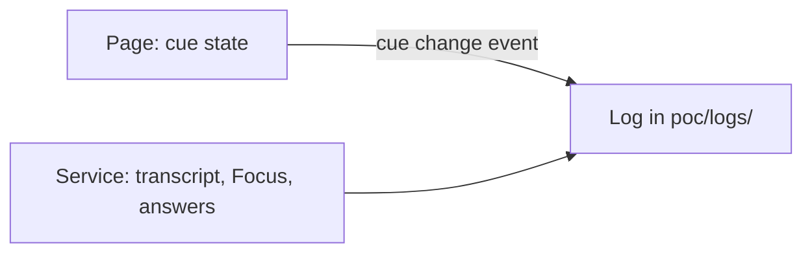

# Meeting log: Pablo's decisions and asks to 05

Part of [what the log must let Pablo learn](01-meeting-log-learning-needs.md). Owner: 12 Observability. 05 decides which asks it accepts; 00 Governance recommended accepting schema version, two clocks and header and declining cue-change events and transcript confidence for now.

## Decisions of 19 November 2026 and what 05 is asked to add

Pablo decided, per 00 Governance: the log lives in the project in a Git-ignored `poc/logs/`; the bullets shown are logged; other people's speech is kept, local only; no retention limit; every meeting is logged. A manual cue key holds its cue for 10 seconds.

*Cue state stays computed in the page; only each change is sent to the log as an event, so the log needs no second copy of the state.*

| Ask 05 to add now | Reason |
| --- | --- |
| Cue-change events: new cue, time, rule or "manual key" as cause, and for a manual cue its 10 s hold end | Without them a later review cannot tell why STOP appeared |
| Schema version on every file and line | Cannot be added to old files |
| Two clocks: monotonic ms from session start plus wall time | Cannot be recovered later |
| Header: session id, UTC start and offset, app revision, models, key configured yes/no, thresholds and the 10 s hold value | Keeps old sessions interpretable after tuning |
| Bullets shown, as logged content with their source label | Pablo's decision |

| Can wait | |
| --- | --- |
| "Mark this moment" key, audio file reference, speaker labels, transcription confidence, a derived-metrics file | Useful but addable without breaking old files, if the schema is versioned |

Privacy note for 02 and 05: keeping other people's speech makes `poc/logs/` sensitive; the Git ignore and local-only download must be checked by 04, not assumed.
