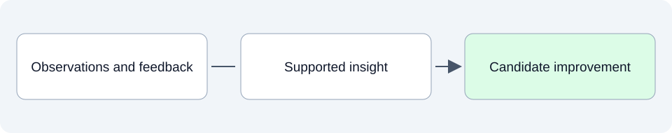

# Learning: improve from what we observe

This folder will turn observed behavior and user feedback into lessons and candidate improvements. It should explain what we learned, how strong the evidence is and what decision it could change.

## SpeakerCoach today

No observability or learning assessment is documented in this stage yet. This folder does not imply that telemetry, analytics or automatic recording has been installed.

## What belongs here as we develop

For a small project, a short note from a real trial may be enough: what happened, whether the cue helped, what was surprising and what we should investigate next. A proposed improvement becomes planned work only after it is selected.

## Explore

- Use [operational observations](../11-operational-reality-devops-and-user-acceptance/README.md) and [evaluation results](../04-benchmarks-and-eval-strategy/README.md); take selected improvements back to [Planning](../07-planning/README.md).

Read files in order: **01 Intended**, **02 Current**, **03 Planned**. Additional topics use dotted numbers such as `01.1` or `03.2`; release and sprint plans identify their horizon in the filename and text.
See the [folder guide](../../../asdg/00-governance/docs/stage-layout.md) for consolidation at cycle closeout. Return to [project documentation](../README.md).
