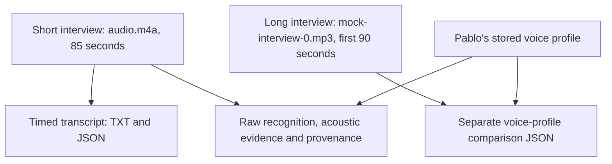

# Interview audio, transcript and speaker analysis

This folder gathers the offline analysis prepared on 25 October 2026. It contains work from **two different interview recordings**.
Start with [transcript.txt](transcript.txt) to read the short interview, or [audio.m4a](audio.m4a) to listen to it.
Pablo considers this transcript and its timestamps good enough for the current evaluation; they have been left unchanged.

## Short interview: read or listen

This approximately 85-second interview was captured in an OBS video and exported as audio. It is a separate recording from the longer MP3 at the parent folder.

| File | What it is for |
| --- | --- |
| [audio.m4a](audio.m4a) | The short interview audio used for the transcript and analysis in this folder. |
| [transcript.txt](transcript.txt) | The easiest version to read: recognized words, timestamps, speaker labels and review notes. |
| [transcript.json](transcript.json) | The structured version for tools: segments, words, timing, estimated speakers and overlap. |
| [asr-raw.json](asr-raw.json) | Original automatic speech-recognition output and settings, before assembling the speaker-labeled transcript. |
| [speaker-acoustic-evidence.json](speaker-acoustic-evidence.json) | Voice comparisons, detected speech and overlap estimates supporting the speaker annotations. |
| [provenance.json](provenance.json) | Where the recording came from, file hashes, model versions, processing choices and known limitations. |

Times are seconds from the first decoded audio sample. Speaker and overlap labels remain estimates; accepting the transcript as a working reference does not establish recognition accuracy.
The original draft labels and internal recording ID remain in the files to preserve their history.

## Longer interview: a separate voice comparison

[sc-b001-profile-probe-2026-10-25.json](sc-b001-profile-probe-2026-10-25.json) compares the first 90 seconds of [mock-interview-0.mp3](../mock-interview-0.mp3) with [Pablo's voice profile](../voice-profiles/pablo-ecapa-v1.json).
It contains window scores and two speaker examples confirmed by Pablo. It does **not** describe this folder's 85-second audio, and is not a full transcript or an accuracy score.
Read the [comparison explanation](../../docs/asdg/04-benchmarks-and-eval-strategy/03.4-voice-profile-probe.md) for its interpretation.

These are offline evaluation materials. They do not demonstrate live application behavior or real-time input isolation.
The folder replaces the former results directory and its dated OBS subfolder; file contents, hashes and historical receipts are preserved.
[Back to evaluation data](../README.md)
