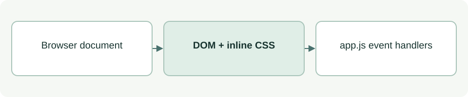

# Meeting Helper browser page

[Source: index.html](index.html)

Provides the full-screen feedback surface, manual controls and diagnostic overlay for the SpeakerCoach prototype.

## Responsibilities and collaborators

Owns document structure, responsive inline CSS and the initial GOOD appearance; delegates behavior to app.js.

- [app](app.md): Binds click handlers, microphone acquisition, timing and display updates.

## Interface and data

DOM contract: `#panel` is a div, `#debug` a pre element, `#listen` a button, and `#controls button[data-state]` carries good, land or stop. There are no exported programming functions.

| Callable or interface | Contract |
| --- | --- |
| `Document load` | Initializes a green GOOD panel and loads app.js after the DOM elements. |
| `Manual state controls` | Supply data-state values consumed by the script. |
| `Viewport layout` | Uses viewport-relative sizes and fixed overlays; overflow is hidden. |

## Effects and failure behavior

Changing element IDs or data-state values requires a matching JavaScript change. The visible page title is Meeting Helper. Small-window readability and microphone availability depend on the browser and need runtime checks.

## Example

Open the page through the project's browser hosting setup; use its manual controls to inspect the three feedback labels.
