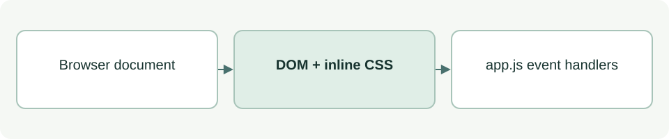

# Alice Good Meetings browser page

[Source: index.html](index.html)

## What this page is for

Alice Good Meetings is the screen a person keeps open on a second monitor while they are in a meeting. A slim bar at the top is the cue: green for GOOD, amber for LAND IT after about 25 seconds of speaking, red for STOP after about 35 seconds. Below it sit the confirmed Question in very large bold type, a smaller candidate question, Alice's suggested bullets and, beside them, the last 30 seconds of what Alice hears. The old screen's Details box and the Good, Land it and Stop buttons are gone, and no key sets the cue: it follows the speaking timer alone. Space confirms the candidate and Esc clears it.

This prototype times how long someone talks. It does not identify who is speaking or judge whether an answer is good. See [Purpose](docs/asdg/02-purpose/01-purpose.md). The older screenshots were of the previous layout and are not repeated here; the page check of S4-19 will take new ones.

## Responsibilities and collaborators

Owns document structure, responsive inline CSS and the initial GOOD appearance; delegates behavior to app.js.

- [app](app.md): Binds click handlers, microphone acquisition, timing and display updates.

## Interface and data

SPRINT-004 screen (rules SA, SS and SC of [08](docs/asdg/08-low-level-design/03.7-sprint-004-screen-specification.md)). Five areas stack in `#page`: the sticky bar `#cue-band`, an error row `#error-row` (hidden unless there is a cause), the Question `#focus`, the candidate line `#live`, and two columns, `#answer` ("Alice suggests") and `#hear` ("What I hear").

| Callable or interface | Contract |
| --- | --- |
| `#cue-band` | The bar: left `#bar-name` ("Alice Good Meetings", 20 px bold), an empty centre reserved for a later message area, and on the right the buttons `#listen`, `#stop-listen`, `#upload-package`, `#download-log`, then the cue word `#panel` and the monitor line `#monitor`. Its colour is the cue (GOOD `#1b7f2a`, LAND IT `#a35c00`, STOP `#b3261e`, white text) and its `aria-label` carries it. |
| `#error-row` | One bold row with the cause (no service, no key, key refused, microphone refused, connection lost, session limit); hidden when there is none. |
| `#focus` | The Question: `#focus-question` in bold, sized by length (`medium` over 90 characters, `long` over 180) and never under 1.5 times the bullet size (SA-13), so medium and long questions show at that floor; with `#focus-status` ("confirmed 10:42:07 · by pause", or "Last known, not live"). |
| `#live` | The candidate: `#live-question`, its tag `#live-tag`, the note and feedback line, the hint `#confirm-hint` ("Space confirms" or the reason Confirm is off), `#confirm-question` and `#clear-live`. |
| `#answer` | "Alice suggests": tag, at most three bullets `#bullets` (no details area), message and reason lines, and the foot with `#package-line`, `#remove-package` and `#package-notice`. |
| `#hear` | "What I hear", live, last 30 s: `#hear-text` shows the service's `items`; the newest is bold, earlier ones are faded. |
| Cue | Follows the speaking timer alone. No key and no button sets it; the G, L and S keys were removed on 22 November 2026 at Pablo's request. |
| `#debug`, `#server` | Hidden unless the address ends in `#diagnostics`. |

Bold is only on the cue word, the Question, tags, bullets, the newest words, an enabled Confirm, the error row and the package notice. Content changes in place with no animation. All visible text says "meeting", never "interview".

## Effects and failure behavior

Changing element IDs requires a matching JavaScript change. The page scrolls in a short window and no area clips its text. The measured sizes (SA-8 to SA-13), the window sizes and the keyboard and focus behavior are covered by the [page check](poc/browser-protocol.md). The bullet size is the variable `--bullet-size`; the Question's floor is computed from it, so changing one keeps the size order.

## Example

Run `bash poc/alice-run.sh` (or `bash poc/start.sh`) and open http://127.0.0.1:3000. See [POC results](poc/RESULTS.md).

## The avatar box (SPRINT-004)

`#avatar` is a round box at the left end of the bar (56 px; 48 px under 900 px wide, 36 px under 500, 40 px in a window under 640 px high with no caption), `aria-hidden`, with `data-avatar-state` (idle, listening, question, researching, ready or error) and `data-avatar-frames` (a draw counter). `#avatar-toggle` (32 × 32 px, `aria-pressed`, label "Avatar") follows Download log. An import map in the head maps `three` and `three/addons/` to the vendored copy under `/poc/vendor/three/`; the page asks only its own origin for the avatar's files.
