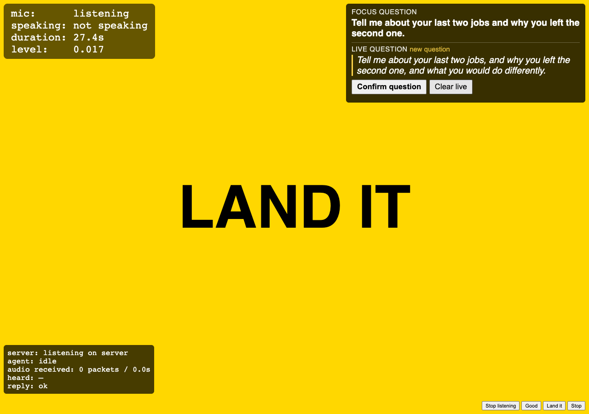
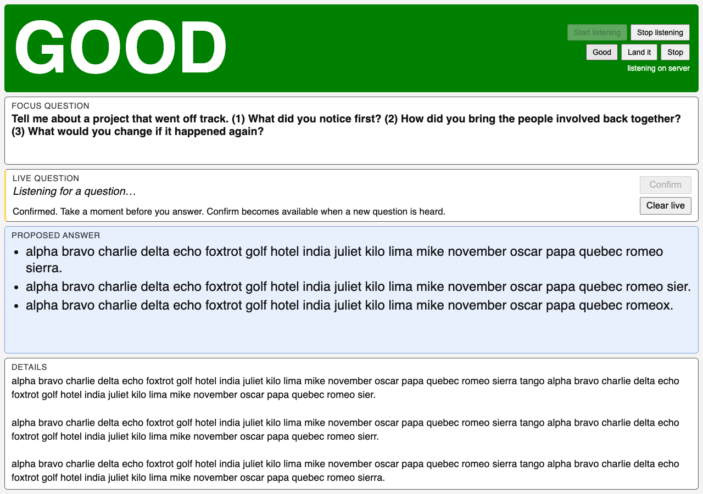

# Meeting Helper browser page

[Source: index.html](index.html)

## What this page is for

Meeting Helper is the screen a person keeps open, on a second monitor or phone, while they answer questions in an interview or meeting. It tells them at a glance whether they are fine to keep talking or should wrap up, so they don't have to watch a clock or lose track of time mid-answer.

The page listens through the microphone and times how long the person has been speaking. The large word in the middle changes as the answer goes on:

- **GOOD** (green): keep going.
- **LAND IT** (yellow): after about 25 seconds of speaking, start concluding.
- **STOP** (red): after about 35 seconds, finish now.

The small panels are for whoever is testing the prototype, not for the speaker during a real conversation. The top-left panel shows the microphone level and how long the current turn has lasted. The bottom-left panel shows what the local server heard and what the reasoning agent replied. The buttons in the bottom-right corner start and stop listening, or set the signal by hand.

*Screenshot of the actual page, captured on 30 October 2026 at 1280 × 720 in headless Chrome driven by Playwright, connected to the local POC server. The microphone was fake: Chrome played a synthetic speech file made with macOS `say` (a short interview question and answer), and real OpenAI transcription and agent calls produced the text shown. In this run the controller rejected a later agent proposal and kept its earlier reply, so no `question:` line appears. The screenshot shows how the page looks, not that it works; that evidence comes from `poc/browser-smoke.mjs`, which passed the same day. The yellow and red states are not shown.*

The panel at top right shows two questions at all times. The **Focus question** is the main question you are answering; it changes only when you press **Confirm question**. The **Live question** is what the page currently hears as the question, updated automatically, with a small tag saying whether it sounds like a new question or a restatement. When an answer is done and a new question appears in Live, Confirm question makes it the new Focus. **Clear live** clears Live if it picked up the wrong words; nothing automatic ever changes Focus.

*Screenshot captured on 4 November 2026 at 1280 × 900 in headless Chrome by `poc/browser-protocol.mjs`. The page and its scripts are real, but the server side was scripted: no local service, transcription or OpenAI call produced this text. It shows the layout, not live recognition. A 390 × 844 capture is in [poc/docs/images](poc/docs/images/uc04-question-panel-narrow.png).*

This prototype times how long someone talks. It doesn't identify who is speaking or judge whether an answer is good. See [Purpose](docs/asdg/02-purpose/01-purpose.md) for the longer-term goals.

## Responsibilities and collaborators

Owns document structure, responsive inline CSS and the initial GOOD appearance; delegates behavior to app.js.

- [app](app.md): Binds click handlers, microphone acquisition, timing and display updates.

## Interface and data

DOM contract: layout B, cue first, in a `#page` grid of five rows. `#cue-band` holds `#panel` (the cue word) and `#controls` with `#listen` (Start listening), `#stop-listen`, the `button[data-state]` cue buttons (good, land, stop) and the reason line `#listen-reason`. `#focus` holds `#focus-question` and `#focus-status`. `#live` holds `#live-question`, `#live-tag`, a small line with `#live-note`, `#question-feedback` and `#confirm-hint`, and the native `#confirm-question` (label Confirm) and `#clear-live` buttons, which start disabled. `#answer` holds `#answer-tag`, `#answer-message`, the `#bullets` list and `#answer-reason`; `#details` holds `#details-text`. `#debug` and `#server` are hidden pre elements, shown with `#diagnostics` in the address. There are no exported programming functions.

*Screenshot of the page at 1280 × 900, taken by `poc/browser-protocol.mjs` against the real service with fixtures and invented text, no OpenAI. A 390 × 844 capture is [alice-page-shown-long-narrow.png](poc/docs/images/alice-page-shown-long-narrow.png).*

| Callable or interface | Contract |
| --- | --- |
| `Document load` | Initializes a green GOOD cue and loads app.js after the DOM elements. |
| `Manual state controls` | Supply data-state values consumed by the script. |
| `Viewport layout` | The approved preview's values: row heights 160, 124, 96 and 232 px at desktop (188, 190, 196 and 460 px up to 700 px wide), details taking the rest and scrolling inside itself, 8 px padding and gap; see [03.5.11](docs/asdg/08-low-level-design/03.5.11-s003-fixed-layout-values.md). No animation or transition. |
| `Answer card and details` | Show the seven states of the proposed answer as plain text; no button, link or collapse control. |
| `Diagnostic readouts` | `#debug` and `#server` stay off the glance layout and are shown only with `#diagnostics`. |

## Effects and failure behavior

Changing element IDs or data-state values requires a matching JavaScript change. The visible page title is Meeting Helper. Small-window readability and microphone availability depend on the browser and need runtime checks.

## Example

Run `bash poc/alice-run.sh` (or `bash poc/start.sh`) and open http://127.0.0.1:3000. See [POC results](poc/RESULTS.md).
