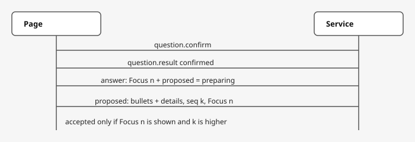

# Design

## Context

See the [proposal](proposal.md) for why. The exact contracts, with rule IDs, are the 08 pages [specification](../../../docs/asdg/08-low-level-design/03.5-sprint-003-specification.md) and [test map](../../../docs/asdg/08-low-level-design/03.6-sprint-003-test-map.md); this file records the technical choices and does not restate them. Current code, read not run on 18 November 2026: `poc/session.mjs` holds one `InterviewSession` per connection with `state` (revision, phase, reply, focus, focusVersion, live), `poc/server.mjs` takes `reason`, `connect` and `audit` as options and answers `/health` with status, configured and sessions, and `poc/alice-run.sh`, the page's answer card and `/preview` do not exist. UC-04's Focus and Live change is in flight and is the base.

## Goals / Non-Goals

**Goals:** make each 08 rule testable with injected generator, connection, clock and package folder; keep the answer out of the interview agent; keep every state reachable without OpenAI.
**Non-goals:** a second model call, bullets before details, a package notice before Start, other context kinds, a database.

## Decisions

**A separate answer area.** The answer is a field `proposed` beside `state`, not inside it. `state.revision` guards Live updates and is copied into snapshots and cached controls, so an answer inside `state` would stale Live updates and replay old text. Instead the `answer` message carries `proposed` only at Confirm, and later results travel in a new `proposed` message with its own rising sequence. Alternative: bump `revision` per answer; rejected, it breaks CT-11.

**A separate generator.** `generate(request, {signal})` is a second injected function, as architecture decision 01 selected (option A), not part of the interview reasoner. It may be an Agents SDK agent or a direct model call; 09 chooses, and its model is configured separately.

**Refuse, never cut.** A result over a limit or with an unknown field is rejected whole and retried once, as the package is, so no half answer or half package is ever shown. Alternative: truncate; rejected as unreviewable for a person who reads a glance.

**Strict, small loader.** Regular `.txt` and `.md` files only, no links, one unreadable file voids the package, so what is sent is exactly what Pablo can list. A larger format set or recursion is a later option.

**Timing on the service clock.** All times are taken by the service, with the page's render report as t3, so no clock on the page is trusted. Speech start is the first voiced packet the server already detects.

**Run script in the terminal.** It mirrors `start.sh`, probes with Node's own fetch (no extra tool) and finds an older service by its listening port. Alternative: a background service with a log file; rejected because a log could capture the private print output.

## Risks / Trade-offs

[One call makes bullets wait for details] → bullets and details are separate fields; the live session measures the delay (S003-LIVE).
[30-second attempt timeout may be too long or short] → provisional, reviewed after the live session.
[Limits and layout values could drift from the approved preview] → they were fixed on 18 November 2026 from the approved files by hash; a changed preview needs a new approval (PV-6).
[The package may hold a meeting link or benchmark text] → the print option and the reviewer-run package check; the loader cannot judge content.
[Ending an older idle service by its port is a side effect] → Pablo accepted it as R6 on 18 November 2026; the script never ends a service with an active session.

## Open Questions

Whether to open the page from the run script, and the final names of new settings, can be answered later without changing the specs or tasks.
