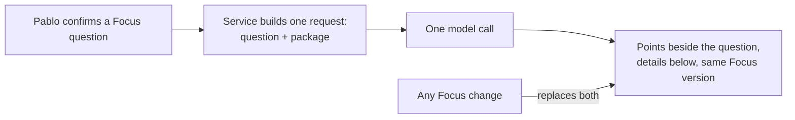

# SPRINT-003: a proposed answer for the Focus question and a new page

## Why

During an interview Pablo glances at Alice (Alice.Good.Meetings) while he reflects and answers. SPRINT-003 gives that glance something to hold: up to three short points beside the Focus question and supporting details below, built from the question and his interview preparation package, on a new page layout he approves from a preview first. Without a key the page must still load and say plainly what is unavailable.

*The answer always belongs to the Focus question on screen; the cue, timer, Focus and Live never depend on it.*

## What Changes

- A **proposed answer** (at most three bullets plus details) from one model call for each confirmed Focus question, replaced on every Focus change, with one service retry and the seven answer states.
- An **interview preparation package** loaded from the Git-ignored `poc/context/interview/` (plain text or Markdown, 20,000 characters, `README.md` skipped, an oversized package not used and never cut).
- The **new page**: cue first, Focus and answer cards, Live bar, a details area that scrolls only inside itself; General, Failed, Unavailable and Last known wordings.
- **`/health`** gains a service name, start time and package fact; the page handles three no-key cases without contacting OpenAI.
- **`poc/alice-run.sh`**: start the service or reuse one already running, without interrupting a session or printing the key.
- A **static layout preview** Pablo approves by hash before `index.html` changes, and fixture hooks so every state is testable without OpenAI.
- **BREAKING** for the paired page and service only: a new server message `proposed`, an extended `rendered` report and new `/health` fields; both ship together.

## Capabilities

### New Capabilities

- `proposed-answer`: request, result, controller states, retry, timing points, print option and the replaceable inputs for tests.
- `answer-package`: the preparation package loader and its statuses.
- `proposed-answer-page`: what the page shows in each state and how it stays glanceable.
- `service-health`: `/health` and the three no-key cases.
- `run-command`: `bash poc/alice-run.sh`.
- `layout-preview`: the static preview Pablo approves.

### Modified Capabilities

None: `openspec/specs/` holds no capability. The UC-04 change `uc-04-confirm-current-question` is in flight and is built on, not modified.

## Impact

Touches `index.html`, `app.js`, `index.md`, `app.md`, `poc/server.mjs`, `poc/session.mjs`, `poc/agent.mjs`, new service modules, `poc/poc.test.mjs`, `poc/browser-protocol.mjs`, `poc/alice-run.sh`, `poc/preview/` and companions, all inside the sprint scope. It adds no database, no new provider and no collapse control. The root `AGENTS.md` and `poc/README.md` data statements change at T31 and T32. Criterion 9's "only those are sent" means the answer request alone, decided by Pablo on 18 November 2026. Pablo accepted 08's choices R1 to R10 on 18 November 2026 and put the reviewer script at `poc/review/package-check.mjs`. Excluded: a second model call, a package notice before Start, other meeting types.

## Source baseline and decision status

Sprint SPRINT-003 is active on branch `sprint-03`; its nine criteria and twelve `S003-*` commitments are the sprint record. Every source below is a draft with no recorded human acceptance; "decided" means Pablo's direction of 16 and 18 November 2026 as relayed by 00 Governance. The [08 specification](../../../docs/asdg/08-low-level-design/03.5-sprint-003-specification.md) (124 rules) and [test map](../../../docs/asdg/08-low-level-design/03.6-sprint-003-test-map.md) carry the exact contracts; this change links to them rather than copying them. Choices 08 made that the stage pages left open are on its [review page](../../../docs/asdg/08-low-level-design/03.5.10-s003-review-items.md).

| Source (SHA-256 of bytes read, 18 Nov 2026) | Claim used | Status |
| --- | --- | --- |
| [03 UC-05](../../../docs/asdg/03-system-model-and-use-cases/01.5-proposed-answer.md) `ce55eef27d477622c8a71ff0536442edcac236f411bc37e71de4298b1d58379f` | Flow and failures of the answer | Draft; defaults decided |
| [03 answer states](../../../docs/asdg/03-system-model-and-use-cases/01.5.1-proposed-answer-states.md) `669ff1a4f7bb928a4ae994c093a4d07747edbb8e76930559535ae9dc2126ec6a` | The seven states | Draft |
| [04 criteria](../../../docs/asdg/04-benchmarks-and-eval-strategy/01.2-evaluation-criteria.md) `66551232ea442d0adb60056e86fc4c7e016abc52d378a4f3c1ce123db19e832d` | Glance, details and benchmark rows | Draft |
| [04 plan](../../../docs/asdg/04-benchmarks-and-eval-strategy/03.6-sprint-003-evaluation-plan.md) `f81510a1edc2844cd4a2f169f955590d509d5f1b5be7987ff76a6cbe395a02d2` | Checks per commitment | Draft |
| [04 live session](../../../docs/asdg/04-benchmarks-and-eval-strategy/03.6.1-sprint-003-live-session.md) `9346a8136bc0d7444ca6f6bd8c8c2c608588dcc4d5751cf7e47c60aea50566f3` | Pass rule, delay recording | Pass rule decided |
| [05 proposed answer](../../../docs/asdg/05-high-level-design-and-architecture/01.3-proposed-answer.md) `ff2d93c2887595e96c2eb45a0fe0f4a8e971f847b9a4385c69d3897ae53ea129` | Parts, binding, one call | Draft; generator decided |
| [05 start and key](../../../docs/asdg/05-high-level-design-and-architecture/01.4-service-start-and-key.md) `3bfa4c77464d1ce0fdd5f4ec3ea3882e716f94ad16cb80d4b415e290fa2c5d49` | Run path, `/health`, page states | Draft |
| [05 pending state](../../../docs/asdg/05-high-level-design-and-architecture/01.5-pending-state-and-inspectable-inputs.md) `981c5c430435cd509c04de9bd4043427f5238a1a9fefa9121595ea692521d4be` | Inspectable request, print option | Draft; print option accepted |
| [05 package](../../../docs/asdg/05-high-level-design-and-architecture/decisions/Proposed%20answer%20and%20its%20context/02-preparation-package.md) `14cb7837e65958e87eb275338bd72d409f04331d0d6a520085360cf5d799e824` | Location, limit, README rule | Decided |
| [05 data statements](../../../docs/asdg/05-high-level-design-and-architecture/decisions/Proposed%20answer%20and%20its%20context/03-data-statements.md) `466fb948365845dfe948b90e9d54d8cd915043e7fda26e6125e69a04b43edc03` | What is sent | Draft; reading of "only" decided |
| [04 package and statement checks](../../../docs/asdg/04-benchmarks-and-eval-strategy/03.8-sprint-003-package-and-statement-checks.md) `1d411245a9743746dc5835821a502cddedb612cf2d5a93d1fa28f6ba62c41c9f` | Reviewer-run checks; script at `poc/review/package-check.mjs` (decided) | Draft |
| [00 preview approval](../../../docs/asdg/00-governance/03-sprint-003-preview-approval.md) `69f9694d593116826d8430fe4b692b4e47ad31c83b43f225cb117b7675376188` | Pablo approved the preview on 18 Nov 2026 19:09 UTC; files `index.html`, `preview.css`, `preview.js` by hash | Recorded decision |
| [10 PG-3 baseline](../../../docs/asdg/10-document-review-and-release/03.3-sprint-003-pg3-baseline-text-sizes.md) `194c03f4a7486fe7f3cd95a54b42a041cf0c599861d22e49d34c0d2be56e4952` | Cue 128 px, Focus and Live 19.8 px at 1280 × 900 | Draft |
| [07 plan](../../../docs/asdg/07-planning/03.9-sprint-003-plan.md) `d9e417f155564b91d2e27f3aecff0087107e724252661d418c637ba2dad5fd02` | Tasks T10 to T43 | Draft |

Recheck these hashes before apply; a changed source needs a new assessment, not an inherited approval.
