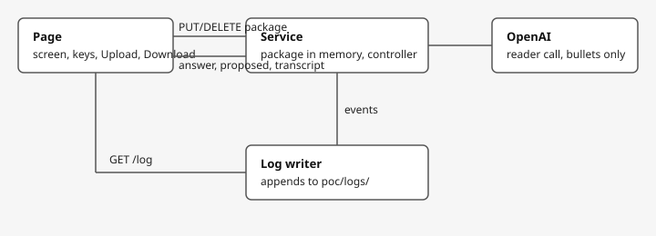

# Design

## Context

See the [proposal](proposal.md) for why. The exact rules, with IDs, are the 91 rules of the 08 [specification](../../../docs/asdg/08-low-level-design/03.7-sprint-004-screen-specification.md) and the 106 checks of its [test map](../../../docs/asdg/08-low-level-design/03.8-sprint-004-test-map.md); this file records the technical choices and does not restate them. Current code, read not run on 19 November 2026: `poc/server.mjs` serves the page, `/health` and the `/session` socket; `poc/session.mjs` holds one `InterviewSession` per connection; `poc/agent.mjs` has the reader's schema with bullets and details; the package is read from `poc/context/interview/` at each Start; no write route, log or `GET /log` exists; the cue is computed in `app.js` by a timer. SPRINT-003's change is built and is the base.

## Goals / Non-Goals

**Goals:** make every 08 rule testable with injected generator, connection, clock, package folder and log folder; keep package text out of every log and route; keep the cue in the page.
**Non-goals:** zip, folder pick, the term list, the idle-pause guard, a raised limit, speaker labels, cue-change events and transcription confidence in the log (05 declined them), any retention or consent control.

## Decisions

**Page decodes, service backstops.** The page reads each file's bytes with a fatal UTF-8 decoder and names a bad file before sending; the service receives text and so can only refuse U+FFFD or NUL. Alternative: send bytes in JSON; rejected, it grows the body and adds a decoder to the service.

**One staged package in service memory.** Upload, Remove and `GET /package` act on one package owned by the service, not by a session, so the status works before Start and Start takes a snapshot. Alternative: a package per session; rejected, the upload comes before Start.

**One append-only log writer.** The controller's events feed a single writer that appends one line per event and never reads, so a write failure cannot stop a session; `GET /log` reads the newest file's complete lines. Alternative: reuse the audit; rejected, the audit is for developers and holds counts, not speech.

**Log in the project, Git-ignored.** `poc/logs/` with its own `.gitignore`, as Pablo decided for this unsynced copy; `ALICE_LOG_DIR` moves it. Alternative: a folder outside the project; Pablo chose this one.

**The cue stays in the page.** Keys set it in `app.js` with a 10-second hold on the page's standard clock, so the page check controls time with its clock emulation. The service never learns the cue, so the log has no cue events.

**The avatar is an optional adapter.** One separate file, `poc/avatar.js` (with `poc/avatar.md`), loaded after the page is ready by a dynamic import, reads a frozen copy of the page state and publishes only `data-avatar-state` and a frame counter on its box; any failure removes the box and the toggle, so the page is as before. TalkingHead, three.js and the model are vendored in `poc/vendor/` with their licences and listed in the service's fixed file list, because a CDN script would run in the page that holds the microphone (05 01.11). Alternative: a CDN; rejected for that reason. The exception to SA-16 is Pablo's and is confined to the box.

**Bullets only, in both calls.** The reader's schema and instructions and the fallback result both drop `details`; a stray field rejects the result, as RS-4 does for any unknown field.

**Transcript as items.** The `transcript` message becomes a snapshot of the last 30 seconds that replaces the previous one, with item ids matching the log's `itemId` and offsets in milliseconds from the session start, so the right column can bold the newest item and fade the rest.

## Risks / Trade-offs

[A model returns `details` anyway and answers fail more often] → the instructions and schema forbid it; the live session measures it.
[The log keeps other people's speech with no expiry] → local only, Git-ignored, decided by Pablo; the statements say so.
[An animated face draws the eye or loads a modest laptop during a call] → a 56 px box at the left end of the bar, about 15 fps, paused when hidden, off with reduced motion, a visible toggle and the key A; the live session watches for jank.
[Space and Esc as global keys surprise] → they act only outside buttons, links and fields and only with a candidate (SC-10).
[A 5 MB log may not cover a very long meeting] → it ends with `log_full`; the live session reports bytes per hour.
[12's other asks (a mark key, an audio reference, speaker labels, cue events) are not in version 1] → the versioned header lets them be added later without breaking old files; cue events are a SPRINT-005 candidate.

## Open Questions

None that would change the specs or tasks: the exact wording of 05's bullets-only change and the wording of 05's bullets-only change can be settled without changing the task breakdown.
