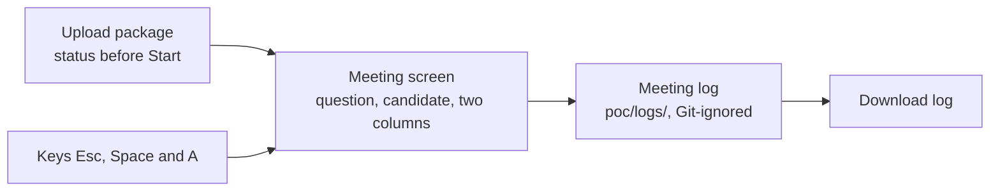

# SPRINT-004: upload a package, keep a meeting log and use the new screen

## Why

Pablo wants to use Alice (Alice.Good.Meetings) in every meeting. Today his preparation package must be placed in a folder on the machine, nothing records what happened in a meeting, and the page is built for interviews with fixed rows, a details box and cue buttons. SPRINT-004 lets him load his package from the page, see what is loaded, work from a calmer screen and keep a complete local log of each meeting that he can download.

*Three streams meet in one recorded live session: the package, the screen and the log.*

## What Changes

- **Upload and status.** Several `.md` or `.txt` files replace the package from the page, in memory only, with `GET /package` for status, `DELETE /package` for Remove, and refusals that keep the old package.
- **Meeting log.** One JSON Lines file per listening session in Git-ignored `poc/logs/`, with a header (the schema version once, in the first line), two clocks, complete up to 5 MB, and `GET /log` for Download log.
- **New screen.** A cue-coloured bar with the avatar and the small name on the left, an empty centre reserved for a later "Alice says" area and the buttons, cue word and monitor line on the right, one very big question, a smaller candidate line, "Alice suggests" and "What I hear", with states for not listening, listening, candidate, pending, error and package missing; the page scrolls and nothing is clipped.
- **Keys.** Esc clears and Space confirms; the three cue buttons leave the screen. **Changed on 22 November 2026 by Pablo's decision:** the keys G, L and S and their 10-second manual cue hold, which this change first added, are removed, and the cue comes from the timer only (08 rules SC-2, SC-7, SC-10, SC-11 and SS-11).
- **Avatar.** A small animated face of Alice in the bar, on by default, as Pablo's named exception to the no-motion rule, with a visible toggle and the key A, vendored and failing silently.
- **Bullets only.** Both the post-pause reader call and the fallback answer request return at most three bullets and no details.
- **BREAKING** for the paired page and service only: new routes, a `transcript` message with items, a `proposed` message without `details`, and a log.

## Capabilities

### New Capabilities

- `package-upload`: upload, status, Remove, limits and refusals of the preparation package.
- `meeting-log`: the per-session log, its content, format, storage and retention.
- `log-download`: `GET /log` and the Download log button.
- `meeting-screen`: areas, sizes, bold, contrast, scrolling, states and wording of the screen.
- `screen-controls`: the buttons, the keys Space, Esc and A, and the cue from the timer only, with no cue key and no manual hold.
- `avatar` (S004-AVATAR, plan criterion 11): the small animated avatar of Alice in the bar, its states, limits, toggle and quiet failure.
- `bullets-only-answer`: the answer without details in the reader call and the fallback request.

### Modified Capabilities

None: `openspec/specs/` holds no capability. SPRINT-003's change `sprint-003-proposed-answer` is built and is superseded in places by `bullets-only-answer` and `meeting-screen`.

## Impact

Touches `index.html`, `app.js`, `index.md`, `app.md`, `poc/server.mjs`, `poc/session.mjs`, `poc/agent.mjs`, new service modules for the package and the log, `poc/poc.test.mjs`, `poc/browser-protocol.mjs`, `poc/logs/.gitignore` and companions. It adds a vendored avatar library (TalkingHead and three.js, MIT) and a CC0 model in `poc/vendor/` with their licence files, entries in the service's fixed file list and the adapter `poc/avatar.js` with `poc/avatar.md`, and no database and no package. Out of scope by Pablo's decision: the idle-pause guard (SPRINT-005), zip, folder pick, the user's term list, a silver-haired Alice model (later),  a raised 20,000-character limit, other people's speech under security rules, and any retention or consent control for the log. The root `AGENTS.md` statements are applied by ASDG Admin 2 and `poc/README.md` agrees.

## Decisions and source baseline

On 19 November 2026 Pablo decided, as relayed by 00 Governance: the log is in Git-ignored `poc/logs/` and he deletes the files; bullets shown are logged; every meeting is logged; keys G, L and S, Esc and Space; a manual cue holds 10 seconds (both withdrawn on 22 November, see the next sentence); the avatar is on by default as an explicit exception to the no-motion rule, with a visible toggle, the key A and the CC0 example model first; no details are requested; files only; the 20,000 limit stays. On 22 November 2026, during his live session and as relayed by the Team Lead, Pablo removed the keys G, L and S and the manual cue hold, saying there is no point in telling himself good, land it or stop; Esc and Space stay and the cue comes from the timer only. 05 decided 12's suggestions on 19 November 2026: a schema version, two clocks and a session header are in; cue events and transcription confidence are not. No source below has a recorded human acceptance, so each is a draft or relayed direction, never an accepted requirement. The exact rules are the 81 of the 08 [specification](../../../docs/asdg/08-low-level-design/03.7-sprint-004-screen-specification.md); this change links to them and does not copy them.

| Source (SHA-256 of bytes read, 19 Nov 2026) | Claim used | Status |
| --- | --- | --- |
| [03.14-sprint-004-working-plan.md](../../../docs/asdg/07-planning/03.14-sprint-004-working-plan.md) `5bea9e624d8266b8f0ecb018639119db8119c19e9d5f183c86384828150b6211` | Plan v6: theme, criteria 1 to 10 | Draft |
| [03.15-sprint-004-review-brief.md](../../../docs/asdg/07-planning/03.15-sprint-004-review-brief.md) `f287d7158e4735cc0f9e2bc3872f40a3e7f6e4bfd2e0a1d6aa7648e3ac949d9a` | Commitments S004-* | Draft |
| [03.16-sprint-004-alignment-report.md](../../../docs/asdg/07-planning/03.16-sprint-004-alignment-report.md) `c9368b187d73a9b9653b5ed79fc72958b2bddaef6175ef24991c368366ea0488` | FOUNDATION_ALIGNED, NOT_READY | Draft |
| [01.7-load-preparation-package.md](../../../docs/asdg/03-system-model-and-use-cases/01.7-load-preparation-package.md) `cdc4d91bba702e39ebe309efa49b60a95c9f011dc47f9556df171d9276abca39` | UC-07 package scenarios | Draft |
| [01.8-meeting-log-and-download.md](../../../docs/asdg/03-system-model-and-use-cases/01.8-meeting-log-and-download.md) `b3326e6fc1da374a7118c726360c0495869b6bd99712b0aa63004db2834b7f47` | UC-08 log and download | Draft |
| [01.9-new-screen.md](../../../docs/asdg/03-system-model-and-use-cases/01.9-new-screen.md) `f192e1aec0374e864768c41e8c4cf3c5da0bd902a07f07522be202d99d45e78e` | UC-09 screen situations | Draft |
| [03.10-sprint-004-upload-log-and-screen-checks.md](../../../docs/asdg/04-benchmarks-and-eval-strategy/03.10-sprint-004-upload-log-and-screen-checks.md) `014c441ccde1193b2201fe2d430659e9ff39398a97313ecddf86484b5d869812` | Reviewer-run checks | Draft |
| [01.8-package-upload-and-vocabulary.md](../../../docs/asdg/05-high-level-design-and-architecture/01.8-package-upload-and-vocabulary.md) `c6550c1a2ed3d3d104be42c4eff9b32cc19cf379e888448b3e660028ad5df050` | Upload design | Draft; Q1 to Q4 decided |
| [01.8.1-upload-limits-and-statements.md](../../../docs/asdg/05-high-level-design-and-architecture/01.8.1-upload-limits-and-statements.md) `31c2576fd39210b3d14ad03b0ff3e0b8f825bf511f2035f711107fc8c58d9291` | Upload limits, names | Draft |
| [01.10-meeting-log-and-transcript-message.md](../../../docs/asdg/05-high-level-design-and-architecture/01.10-meeting-log-and-transcript-message.md) `1cbf82d234949971101bf637d1b31470c86bfdae2dc3925d1c19355c760304e8` | Log writer, transcript message | Draft |
| [03.7-sprint-004-screen-specification.md](../../../docs/asdg/08-low-level-design/03.7-sprint-004-screen-specification.md) `498dcb1d29fd5648ec491838918d356e9e6515025911b1e2f24cd0c8e34b3b9c` | Screen specification, 91 rules | Draft; decisions relayed |
| [03.8-sprint-004-test-map.md](../../../docs/asdg/08-low-level-design/03.8-sprint-004-test-map.md) `b133f55282df1d895b9beffcbfeb8d514f21c36b51720256e4e69929dbe467d1` | Test map, 106 checks | Draft |

Recheck these hashes before apply; a changed source needs a new assessment, not an inherited approval.
