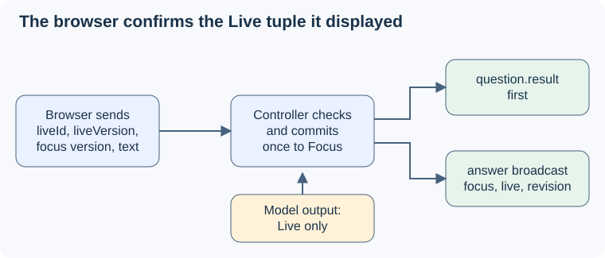

# UC-04 design

## Context

See the [proposal](proposal.md) for the motivation, Pablo's decisions and the ASDG hashes. The readable low-level design, with mockups, is in [08 · Focus and Live question](../../../docs/asdg/08-low-level-design/03-uc-04-focus-and-live-question.md); this file keeps the implementation-facing contract.

The `sprint-01` code implements the 28 October version. The controller has `question`, `questionVersion`, `questionOrigin`, `exchangeId` and a `clarification` draft. Outside clarification, `track()` lets cited `new-question` evidence replace `question` automatically, and that is the 4 November bug. The code below was read, not run, on 4 November; it is uncommitted and may still be changing.

| Source | SHA-256 | Relevant responsibility |
| --- | --- | --- |
| [Controller](../../../poc/session.mjs) | `11af3f3ff5386f545132c265439406aa104b4e80e8e76b9ee4ab884604a56a70` | State, `refine`/`track`, cutoffs, `confirm`, request cache. |
| [Reasoner](../../../poc/agent.mjs) | `d45f553d30e179a692a1302ef0d832fdca7efa4018d9aa1df17872cffd717b91` | Intent schema `none / clarify / new-question / answer` and prompt. |
| [Transport](../../../poc/server.mjs) | `fd7f353e6ed390ca6133ff5222280c0369d7503091c14120a88676d1005888f9` | Control dispatch on `/session`. |
| [Browser](../../../app.js) / [page](../../../index.html) | `051df98202e71385d1c5e66192afae40432a1144d3c218f3dd621224d3e34c7a` / `ec590c215c913f888b68dc1b156965a3693cd4e3365ee14343b98fc3ae7594ed` | Question panel, pending/uncertain handling. |
| [Tests](../../../poc/poc.test.mjs) | `9edd17507a345a94df0f08bbe487b9ce2cba00dfb8b7608fa972f24533a2969d` | Controller and transport cases. |

## Goals / Non-Goals

Goals: implement [live-question](specs/live-question/spec.md), [question-confirmation](specs/question-confirmation/spec.md) and [focus-question](specs/focus-question/spec.md) by changing the existing code. Non-goals: storage, a new provider, automatic reconnect and speaker recognition.

## Decisions

**State.** The state replaces `question`/`questionVersion` with `focus`/`focusVersion` and `clarification` with `live: {id, version, text, kind}`, where `kind` is `new` or `restatement`. `questionOrigin` is removed because Focus is always user-confirmed. Keeping two fields avoids the old single-field conflict between draft and retained question. The [08 state model](../../../docs/asdg/08-low-level-design/03.2-uc-04-state-and-rules.md) has the full transition rules.

**Live from the agent.** The output schema is unchanged. `new-question` sets Live with `kind: new`. `clarify` refines an open Live and keeps its `kind`; when Live is empty, it opens Live as a `restatement` of Focus, but text equal to Focus is ignored. `answer` and `none` leave Live alone. At least one cited observation must be newer than the Live cutoff. Focus has no automatic writer, so a misread intent can only produce a wrong Live.

**Versions and exchanges.** Every Live or Focus change, and every Clear live, increments `revision`, invalidating older reasoning snapshots. Each Live text change increments `live.version`; a new Live gets a fresh `id`. Only Confirm increments `focusVersion`. Confirm keeps `exchangeId` for a `restatement` of an existing Focus and allocates a new one otherwise.

**Exact consent.** Confirm compares `liveId`, `liveVersion`, exact `text` and `expectedFocusVersion` to the canonical state, without normalizing. On a match it sets Focus, sets phase QUESTION and clears Live. It also moves the Live cutoff and retires the id, all synchronously before publishing. The result precedes the `answer` broadcast.

| Protocol | Contract |
| --- | --- |
| `question.reset` | `{sessionId, requestId}` → `reset`; clears Live and moves the cutoff; never touches Focus. |
| `question.confirm` | `{sessionId, requestId, liveId, liveVersion, expectedFocusVersion, text}`; IDs 1–100 characters, safe non-negative integer versions, text 1–600 characters. |
| `question.result` | `confirmed` (adds `liveId`, `liveVersion`, `focusVersion`), `reset`, `stale` (version changed or id retired), `invalid`, `unavailable` (stopped, Live empty, or Live equals Focus), `limit`. |
| `answer` / `rendered` | State carries `focus`, `focusVersion`, `live`. `rendered` names `liveId`/`liveVersion` as display only, never consent. |

**Retries and limits.** Unchanged: identical retries by `requestId` return the cached result, changed payloads are `invalid`, and there is a cap of 256 distinct controls. Retired Live ids are kept in a set bounded by the same cap.

**Browser.** Confirm is enabled when connected, nothing is pending, and Live has text different from Focus. A disabled Confirm shows a hint. Feedback clears when Live changes. The submitted wording freezes while pending; after 5 seconds it shows "uncertain" with an identical retry. Snapshots apply only for the same session and an increasing revision. A new session clears everything.

## Risks / Trade-offs

- Misread intent → only Live is wrong; Pablo ignores it or presses Clear live. Intent accuracy still needs semantic evaluation.
- Focus never updates without a press → Pablo may answer a new question under the old Focus. Accepted: the 4 Nov decision values stability over automation.
- Disconnect after commit → the page shows uncertainty and the last acknowledged Focus; a restart is a new session.

## Migration Plan

Change the controller and tests, then the transport, then the browser and documentation, as listed in [tasks](tasks.md). Ship browser and service together and restart local sessions; there is no stored data. Rollback restores the paired prior versions.

## Open Questions

None from the 4 Nov review. A user-acceptable latency target is still unset; record recognition-to-Live, click-to-commit and acknowledgement-to-render separately.
