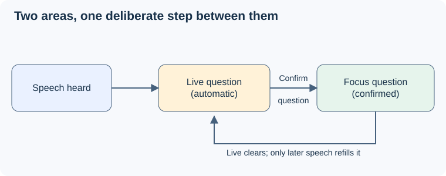

# UC-04: clarify and confirm the current question

## Why

Pablo needs to restate a question aloud, see a faithful draft and confirm the wording he will answer. The POC currently establishes questions automatically, so it cannot distinguish his explicit approval from a model's interpretation.

## What Changes

- Recognized clarification or **Start question** opens a draft that follows Pablo's corrections, including multipart questions, using his voice alone.
- **Confirm question** accepts the precise displayed version into server-side session memory; the page marks it confirmed only after acknowledgement.
- During clarification, silence, confidence and transcript completion cannot promote the draft. Existing question text stays visible during refinement and failure.
- Automatic tracking continues outside clarification. Confirmation preserves a reflection interval and does not itself begin an answer.

## Capabilities

### New Capabilities

- `question-clarification`: recognize or explicitly start clarification, refine a separate draft and keep it readable.
- `question-confirmation`: validate the displayed version, acknowledge its acceptance and handle stale requests and retries.
- `question-tracking`: preserve automatic tracking outside clarification, protect confirmed wording during answers and retain session boundaries.

### Modified Capabilities

None: the existing OpenSpec capability inventory is empty. These deltas describe the new flow and its compatibility boundary; they do not establish that existing behavior has passed evaluation.

## Impact

Expected implementation touches `app.js`, `index.html`, `poc/session.mjs`, `poc/agent.mjs`, `poc/server.mjs`, tests and their Markdown companions. It extends the existing browser/service protocol without choosing a new SDK, database or audio transport; both ends must be updated together. Answer suggestions, cross-session storage and calibrated speaker recognition are excluded.

This is candidate future work. SPRINT-000 remains the streaming/agent POC; this proposal neither adds UC-04 to it nor authorizes implementation. The observed source baseline is checkout revision `c7b911964f0c558849f17ab0edaec8aa89adeeec` with existing local changes; linked hashes below identify the actual bytes used.

## Decisions and source baseline

On 28 October 2026, the user selected **confirmation only during clarification, preserving automatic tracking elsewhere**, and **Pablo's voice alone is sufficient for UC-04, with two-speaker recognition a separate broader goal**. These resolve the conflicts between UC-04 and the earlier Purpose/Architecture direction for this proposal; they are not exact-document acceptance or approval of revised upstream documents.

“Accepted bytes” below means a matching User acceptance hash in [the lifecycle ledger](../../../.asdg/lifecycle.json). Purpose's package remains stale despite matching individual files; the current system model and UC-04 are unaccepted drafts. Stage 04/05 acceptance includes their stated open questions, not measured success or accepted numeric thresholds. The code baseline and proposed contracts are detailed in [design](design.md).

| Source | SHA-256 of inspected bytes | Claim used and status |
| --- | --- | --- |
| [Purpose](../../../docs/asdg/02-purpose/01-purpose.md) | `2b288e476d331b96c7c269ae0f38daf87804e1c49015b0dcfc512b1b4b8601b0` | Attention and visual guidance; accepted bytes, package stale. |
| [Next outcome](../../../docs/asdg/02-purpose/03-planned-improvements.md) | `5319c35ac926315c133fd56badd6e501af278acdad7e097a41d698e73b4fbf4f` | Persistent question and speaker distinction; accepted bytes, narrowed for UC-04 by the user's decision above. |
| [System model](../../../docs/asdg/03-system-model-and-use-cases/01-system-model.md) | `c46b24e1c6e85868c66802d9945b6212c38b5df6c10235b1e641ab28bc533db9` | Shared behavior across answer scenarios; current draft, historical review stale. |
| [UC-04](../../../docs/asdg/03-system-model-and-use-cases/01.4-confirm-current-question.md) | `898bfb00220acd716f9169a98a8e0d9c1c934a9bad6ad93ca0d8e469ba02dd23` | Clarification, visible-version consent and failure scenarios; AI-modified draft without exact acceptance. |
| [Evaluation](../../../docs/asdg/04-benchmarks-and-eval-strategy/01.2-evaluation-criteria.md) | `e1ea9652518ed8401daee8517966f9b6eeb9d578425f164e90e6f5529a65e31d` | Fidelity, persistence, readability and separate usefulness evidence; accepted bytes. |
| [Measurements](../../../docs/asdg/04-benchmarks-and-eval-strategy/03.1-release-measurements-and-thresholds.md) | `dfd3b7293f057170e65ffa08eff5929af3243486b8cde824eba1a0d33d9d6bfe` | Visible timing and misses; accepted document with provisional thresholds. |
| [Architecture](../../../docs/asdg/05-high-level-design-and-architecture/01-architecture.md) | `40061807932a7a431fce8a69889983e52d89c32365f8c90c8b501e60ec866868` | Local service owns session memory; accepted bytes. |
| [Streaming](../../../docs/asdg/05-high-level-design-and-architecture/01.1-streaming-and-replay.md) | `a2fadf092b91e3df038f9a5e2cc5b8b6f7bce31c0ceeb66d96638a1676189c49` | Asynchronous input, revisions, failure and replay isolation; accepted bytes. |
| [Interview state](../../../docs/asdg/05-high-level-design-and-architecture/01.2-interview-state.md) | `ebed2f85ae618967f48a87f384d3a2885a752cb3a689e2e85de61b56b1b1cde4` | Automatic promotion, question persistence and independent phase; accepted bytes with UC-04 exception selected above. |
| [Planning index](../../../docs/asdg/07-planning/README.md) | `19dc04e07f3dc5a717a89ddd14204b923944fc8844e2593a120a557cbf01ee96` | POC active; methodology reviews are not a committed product plan; unreviewed local edit. |
| [Sprint state](../../../.asdg/sprint.json) | `7b67029aa3117e03c8e24f0a3fbc224a4793045997f4a6a6734eadedb87894b2` | Authoritative SPRINT-000 scope observed; no UC-04 transition requested. |
