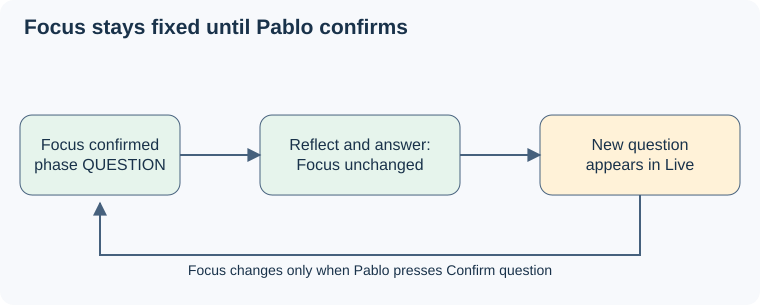

# Focus question

## Purpose

Keep the question Pablo chose to answer fixed and visible until Pablo confirms another, through reflection, answers, failures and session boundaries. The [user decisions and architecture baseline](../../proposal.md#decisions-and-source-baseline) define this boundary.

## ADDED Requirements

### Requirement: Only confirmation writes Focus
The Focus question SHALL change only through a successful confirmation. Model output, new-question evidence, silence, transcript finality and timers SHALL NOT write it. Before the first confirmation the page SHALL show "No focus question yet".

#### Scenario: New question after a confirmation
- **WHEN** Pablo has confirmed Q1 and later speech is interpreted as a new question Q2
- **THEN** Live shows Q2 tagged "new question", Focus still shows Q1, and Confirm question is enabled.

#### Scenario: No confirmation yet
- **WHEN** questions are heard but Pablo has not confirmed any
- **THEN** Focus shows "No focus question yet" and only Live changes.

### Requirement: Reflection and answer preserve Focus
The system SHALL keep Focus in server session context and on the page through reflection, pauses, acknowledgements and answer speech. Confirmation alone SHALL NOT establish ANSWER. A confirmed restatement SHALL keep the current exchange; any other confirmation SHALL start a new exchange.

#### Scenario: Reflection followed by answering
- **WHEN** Pablo confirms a question, pauses, then answers and restates it within the answer
- **THEN** Focus stays the same, the phase changes to ANSWER only from answer evidence, and no new exchange is created.

#### Scenario: Confirming a restatement versus a new question
- **WHEN** Pablo confirms a Live tagged "restatement", and later confirms one tagged "new question"
- **THEN** the first keeps the exchange of the earlier Focus and the second starts a new exchange.

### Requirement: Session failures cannot imply confirmation
The system SHALL keep the last acknowledged Focus visible as "last known, not live" after disconnect or Stop, suppress stale events after Stop, and start each new session with empty Focus and Live. Focus memory is scoped to the live server session.

#### Scenario: Disconnect after submission and subsequent restart
- **WHEN** the connection fails with a confirmation pending and Pablo later starts a new session
- **THEN** the old Focus is shown as last known with the confirmation marked possibly unsaved, nothing is replayed into the new session, and the new session starts empty.

#### Scenario: Stopped session emits a late result
- **WHEN** a result from the stopped session arrives after a new session begins
- **THEN** it cannot alter the new session's Focus, Live or phase.
