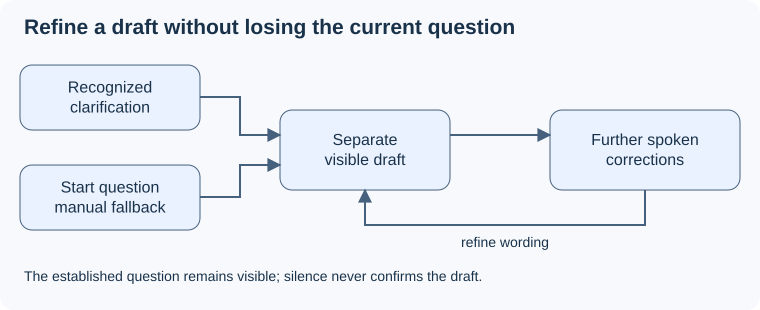

# Live question

## Purpose

Show Pablo, at all times, what SpeakerCoach currently interprets as the question, updated automatically from speech and never treated as approved. The [proposal decisions and sources](../../proposal.md#decisions-and-source-baseline) bind this delta to UC-04 and the attention and fidelity criteria.

## ADDED Requirements

### Requirement: Live is always visible and follows speech
The page SHALL always show a Live question area during a session. The system SHALL update it automatically from interpreted speech, including new questions, restatements, corrections and multipart wording, using Pablo's voice alone. Live text SHALL never be treated as confirmed.

#### Scenario: A question is heard with no interviewer audio
- **WHEN** Pablo says a question aloud and no interviewer audio is available
- **THEN** Live shows that question without a button press, the Focus question is unchanged, and no speaker identity is claimed.

#### Scenario: Corrected multipart wording
- **WHEN** Pablo corrects one part of the Live question and adds another
- **THEN** Live shows the complete corrected wording with every relevant part and no unsupported detail, and silence or model confidence does not confirm it.

### Requirement: Live refills only from later speech
After a successful confirmation or Clear live, the system SHALL clear Live. It SHALL refill Live only from speech heard after that point. Answer speech and restatements of the Focus question inside an answer SHALL NOT fill Live.

#### Scenario: Earlier speech after Confirm
- **WHEN** a model result cites only speech heard before the latest confirmation
- **THEN** Live stays empty and shows "Listening for a question…".

#### Scenario: Restating the question while answering
- **WHEN** Pablo repeats the Focus question as part of an answer
- **THEN** Live is not filled and no new exchange is suggested.

### Requirement: Clear live is a manual fallback
The page SHALL offer a keyboard-operable Clear live control. It SHALL clear Live and exclude earlier speech, and it SHALL NOT change the Focus question or confirm anything.

#### Scenario: Live picked up the wrong words
- **WHEN** Pablo activates Clear live with a mouse or keyboard and then states the question
- **THEN** Live clears, fills only from the new speech, and Focus is unchanged.

### Requirement: Live wording is readable and tagged
The page SHALL show Live wording in full, visually distinct from Focus, with "Listening for a question…" when empty. While Live has text, it SHALL show a small muted tag, "new question" or "restatement", as the agent's interpretation.

#### Scenario: Long or tagged Live wording
- **WHEN** Live holds a long new question at phone or desktop width
- **THEN** the whole wording is readable without truncation and the tag reads "new question".
