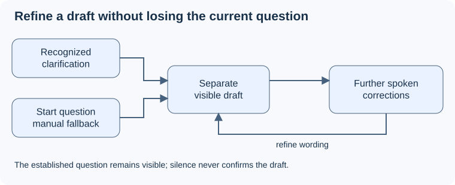

# Question clarification

## Purpose

Let Pablo turn spoken clarification into a faithful, readable draft without requiring interviewer audio. [Proposal decisions and sources](../../proposal.md#decisions-and-source-baseline) bind this delta to UC-04 and the attention/fidelity criteria.

## ADDED Requirements

### Requirement: Clarification can begin from speech or manual intent
The system SHALL open clarification from recognized spoken intent or Start question during an active listening session, without requiring a fixed phrase, interviewer audio or verified speaker identity. Start question SHALL override an interpretation that misses clarification intent without asserting speaker identity.

#### Scenario: Pablo alone clarifies without a button
- **WHEN** Pablo restates a question in his own words, clarification is recognized, and no interviewer audio is available
- **THEN** a separately identified draft appears without requiring Start question or claiming that the speech came from the interviewer.

#### Scenario: Manual fallback and keyboard access
- **WHEN** automatic recognition misses clarification and Pablo activates Start question with a mouse or keyboard, then states the question
- **THEN** the session enters clarification and uses his subsequent speech to form the draft; activation alone neither invents text nor confirms a question.

### Requirement: Draft corrections preserve meaning and remain provisional
The system SHALL reflect spoken corrections and relevant multipart content in the draft, exclude unsupported details and retain the established question separately. Silence, transcript finality and model confidence SHALL NOT confirm the draft.

#### Scenario: Corrected multipart wording
- **WHEN** Pablo corrects one part and adds another while an established question already exists
- **THEN** the candidate incorporates the corrections and all relevant parts, the established question remains visible, and neither is mislabeled as newly user-confirmed.

#### Scenario: Speech ends without confirmation
- **WHEN** Pablo stops speaking and the model considers a draft complete
- **THEN** it remains a draft until explicit confirmation, even if no prior established question exists.

### Requirement: Reviewable text and availability feedback
The system SHALL distinguish the draft from the current question, show complete readable wording and expose whether confirmation is available. During an outstanding confirmation attempt it SHALL keep the submitted wording stable; unavailable, empty or stale drafts SHALL receive actionable feedback without removing the established question.

#### Scenario: Empty or unavailable candidate
- **WHEN** Pablo attempts confirmation before a nonempty draft is available or while the service is unavailable
- **THEN** the page communicates why confirmation is unavailable and preserves any established question.

#### Scenario: Corrections arrive during confirmation
- **WHEN** a newer draft arrives after Pablo submits the version he read
- **THEN** the submitted wording remains identifiable until the result arrives; a stale result requests review of the newer wording rather than silently treating it as approved.
