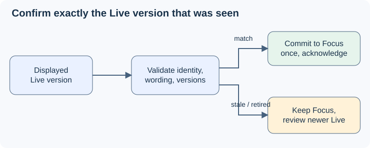

# Question confirmation

## Purpose

Make explicit approval bind to the wording Pablo actually reviewed, with observable acknowledgement and safe failure behavior. The [UC-04 source and user decisions](../../proposal.md#decisions-and-source-baseline) support every requirement below.

## ADDED Requirements

### Requirement: Confirmation commits only the reviewed version
The service SHALL accept confirmation only for the active session's nonempty current draft version and the current established-question version. A successful response SHALL identify the exact approved wording and its server-side session-memory version. The page SHALL show user-confirmed status only after matching server acknowledgement.

#### Scenario: Successful mouse or keyboard confirmation
- **WHEN** Pablo activates Confirm question for a displayed draft whose session, identity, wording and versions still match
- **THEN** the service retains exactly that text, acknowledges its identity and version, and the page marks that wording user-confirmed without beginning ANSWER solely because of the confirmation.

#### Scenario: An unseen newer draft or changed current question exists
- **WHEN** confirmation reaches the service after either the draft or established-question version has changed
- **THEN** the service rejects it as stale, leaves the established question unchanged, and supplies current state for renewed review; it never confirms unseen text.

#### Scenario: Invalid or wrong-session confirmation
- **WHEN** a request refers to an empty, unknown or altered draft, a different session, or a stopped session
- **THEN** no question is committed and any active page receives an appropriate unavailable or invalid-request result without losing its last established question.

### Requirement: Confirmation retries are idempotent
Within a live session, the service SHALL return the original result for an identical confirmation retried with the same request identity and SHALL NOT create another exchange or question version. Reusing that identity with different content SHALL be rejected.

#### Scenario: Acknowledgement is delayed or lost
- **WHEN** the page has no conclusive result for a submitted confirmation and retries the same request in the same live session
- **THEN** it displays pending or uncertain status while retaining the previous acknowledged question, and a repeated success identifies the original committed version without committing twice.

#### Scenario: Retry attempts to approve different text
- **WHEN** a request identity is reused with different draft text or versions
- **THEN** the service rejects the altered request rather than interpreting it as fresh approval.

### Requirement: Acknowledgements cannot roll back newer state
The page SHALL associate results with the submitted request and session and SHALL NOT replace a newer displayed state with an older acknowledgement. An accepted confirmation SHALL invalidate older in-flight model proposals that could overwrite its wording.

#### Scenario: Late model result or acknowledgement arrives
- **WHEN** a model result based on pre-confirmation state or an acknowledgement older than an already displayed state arrives
- **THEN** the confirmed question is protected from the stale model result and the page keeps the newer state while resolving the request's outcome separately.
