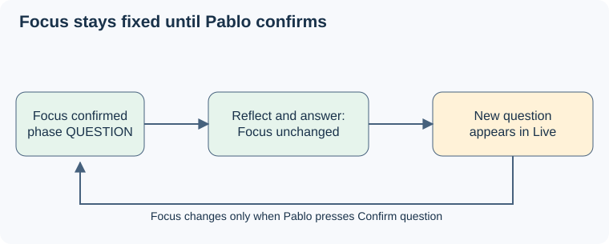

# Question tracking across clarification and answers

## Purpose

Keep automatic question tracking useful outside explicit clarification while preserving the question Pablo confirmed during reflection and answering. The [user decisions and architecture baseline](../../proposal.md#decisions-and-source-baseline) define this compatibility boundary.

## ADDED Requirements

### Requirement: Automatic promotion is scoped around clarification
The system SHALL preserve evidence-driven automatic question promotion outside clarification. While clarification is active, automatic processing SHALL update only the provisional draft. Successful confirmation SHALL close that clarification flow without making explicit confirmation mandatory for every later question.

#### Scenario: Ordinary question outside clarification
- **WHEN** a genuine question is established from available conversation evidence and no clarification flow is active
- **THEN** automatic tracking can establish it without a confirmation click and the page distinguishes automatically established wording from user-confirmed wording.

#### Scenario: No promotion during clarification
- **WHEN** the model proposes a settled question during an active clarification flow
- **THEN** the system retains the established question and treats the proposed wording as provisional until Pablo confirms it.

### Requirement: Reflection and answer preserve the confirmed question
The system SHALL retain confirmed wording in server-side session context and on the page through reflection, pauses, acknowledgements and answer speech. Confirmation alone SHALL NOT establish ANSWER. Deliberate clarification SHALL create a separate draft while retaining the confirmed question; uncertain new-question evidence SHALL preserve the current exchange.

#### Scenario: Reflection followed by answering
- **WHEN** Pablo confirms a question, pauses to think, and then answers or restates it as part of his answer
- **THEN** the same wording stays available and the phase changes to ANSWER only from subsequent answer evidence, without creating another exchange from the restatement.

#### Scenario: Correction or genuine follow-up
- **WHEN** the conversation contains deliberate correction of the current question, a genuine new question, or ambiguous evidence between the two
- **THEN** correction opens a separate draft for the same exchange, a supported new question outside clarification can advance the exchange automatically, and ambiguity preserves the established question without claiming a new exchange.

### Requirement: Session failures cannot imply confirmation
The system SHALL preserve the last acknowledged question visibly with degraded or uncertain status on failure, suppress stale events after Stop, and prevent a new session from inheriting confirmation implicitly. Confirmation memory SHALL be scoped to the live server session; cross-session persistence is outside this capability.

#### Scenario: Disconnect after submission and subsequent restart
- **WHEN** the connection fails with confirmation pending and Pablo later starts a new session
- **THEN** the old display remains explicitly uncertain or historical until reset, pending commands are not replayed into the new session, and its question memory begins empty.

#### Scenario: Stopped session emits a late result
- **WHEN** a result from the stopped session arrives after a new session begins
- **THEN** it cannot alter the new session's draft, phase or current question.
