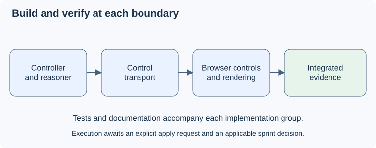

# UC-04 implementation tasks

The 28 October version of this change is already implemented, uncommitted, on `sprint-01`. These tasks change that code to the 4 November Focus/Live design. They are unchecked proposed work, not execution evidence. Application edits need SPRINT-001 scope and the per-target checks. The [proposal decisions](proposal.md#decisions-and-source-baseline) govern scope. The [design](design.md) and the [08 state model](../../../docs/asdg/08-low-level-design/03.2-uc-04-state-and-rules.md) give the interfaces.

## 1. Focus/Live state and reasoning

- [x] 1.1 In `poc/session.mjs`, replace `question`/`questionVersion`/`questionOrigin`/`clarification` with `focus`/`focusVersion`/`live {id, version, text, kind}`. Remove automatic Focus writes from `track()`, and route `new-question`/`clarify` to Live behind the Live cutoff. Verify [live-question](specs/live-question/spec.md) with `node --test poc/poc.test.mjs`.
- [x] 1.2 Add a regression test for the 4 November bug: confirm Q1, then inject a cited `new-question` Q2 from later speech. Focus stays Q1 with `focusVersion` unchanged, and Live holds Q2 with `kind: new`. Also cover answer restatements, `clarify` with Live empty (restatement; equal-to-Focus ignored) and pre-cutoff evidence.
- [x] 1.3 Update the `poc/agent.mjs` prompt for `state.focus`/`state.live`, keeping the schema. Update `poc/session.md`, `poc/agent.md` and `poc/poc.test.md` to match, and render their visuals.

## 2. Confirmation, Clear live and transport

- [x] 2.1 Change `confirm` to take `liveId`/`liveVersion`/`expectedFocusVersion`. Return `stale` for retired ids and `unavailable` when Live equals Focus. Apply the exchange rule: a restatement keeps the exchange, anything else starts a new one. Replace `startClarification` with a Clear live that clears Live and moves the cutoff. Test every [confirmation scenario](specs/question-confirmation/spec.md), including retries and the 256 cap.
- [x] 2.2 In `poc/server.mjs`, accept `question.reset` instead of `question.start` and keep audio framing, origin checks and Stop cleanup. Extend the injected-WebSocket tests for reset, confirm and malformed controls.
- [x] 2.3 Update `poc/server.md`, `poc/docs/04-server-and-protocol.md` and `poc/docs/04.1-question-controls.md` to match the [08 protocol](../../../docs/asdg/08-low-level-design/03.3-uc-04-protocol.md), with reset, confirm, stale-retired and retry examples.

## 3. Browser Focus/Live panel

- [x] 3.1 In `index.html` and `app.js`, show FOCUS QUESTION and LIVE QUESTION at all times, with the empty texts, the muted tag, Confirm question and Clear live, and the disabled-Confirm hints. Keep the colour timer. Check every [panel state](../../../docs/asdg/08-low-level-design/03.1-uc-04-panel-states.md) at desktop and narrow widths.
- [x] 3.2 Bind Confirm to the displayed Live tuple. Freeze the submitted wording while pending, show "uncertain" after 5 seconds, clear feedback when Live changes, and mark Focus "last known, not live" on disconnect or Stop. Extend `poc/browser-protocol.mjs` fixtures for [focus-question](specs/focus-question/spec.md) boundaries.
- [x] 3.3 Update `app.md`, `index.md`, `poc/docs/03-browser-and-audio.md` and the panel screenshots. Label them as captured from the implemented page.

## 4. Integrated acceptance evidence

- [ ] 4.1 Run the live microphone flow with only Pablo audible. Cover a question into Live, Confirm, reflection, an answer with a restatement, a new question appearing in Live while Focus holds, a second Confirm, and Clear live. Record the displayed wording, identities and outcomes.
- [ ] 4.2 Exercise stale and retired confirmations, delayed acknowledgements, network loss, late model output and Stop/restart through browser plus service. Record render, commit and transcript times.
- [ ] 4.3 If replay is used, pass only elapsed audio and keep evaluator references outside analysis. The benchmark transcript and timestamps stay unchanged.
- [ ] 4.4 Save results in `docs/asdg/08-low-level-design/02-uc-04-verification.md` with pass, fail or unverified per scenario, timings and visual evidence. Separate human review is required.
