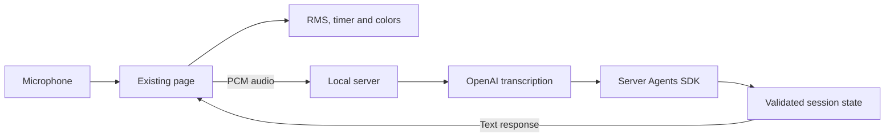

# Alice.Good.Meetings server POC

Read the [visual solution guide](docs/README.md) for the introduction, architecture, module details and code navigation.

The current task preserves the existing browser's microphone meter, speaking timer and colors, and adds visible replies from an OpenAI agent running in the local server.
This is the first demonstration within Sprint 0. Full benchmark replay isolation, speaker identification and product acceptance remain separate work.

The server owns the API key and reads the preparation package. The page receives transcript, agent results and proposed answers, never credentials or the package text.
The original benchmark transcript and timestamps are not inputs to the live agent and remain unchanged.

## Run

Requires Node.js 22+ and the dependencies in `poc/package.json` (`cd poc && pnpm install --ignore-scripts` on a fresh checkout).
The confirmed credential lives in `poc/.env.local`, which is ignored by Git. Its names and optional overrides are documented in `.env.example`.
From the repository root, run `bash poc/start.sh`, then open http://127.0.0.1:3000.
Press **Start listening**, allow microphone access, and wait for **listening on server** before speaking.
The original level, speaking indicator, duration and GOOD/LAND IT/STOP colors continue locally. The server readouts (audio counts, transcript, agent reply) are hidden; add `#diagnostics` to the address to show them. The page shows the confirmed Question, a candidate question, Alice's suggested bullets and the last 30 seconds of what it hears, or why recognition is unavailable when no key is set up. The keys G, L and S set the cue for 10 seconds, Space confirms a candidate, Esc clears it and A switches the small avatar.
Press **Stop listening** to release the microphone and connections. Restart explicitly after a server error. The last answer stays visible with stopped/degraded status.
Microphone audio and selected transcript text are sent to OpenAI while listening. When a session starts, names and terms picked locally from the preparation package are sent with the audio as a transcription hint. After each pause the transcript text and the text of the package go to OpenAI in one request, which reads the question and prepares the proposed answer; there is no Confirm step.
The package is the files chosen on the page or, if none were chosen, the files in `poc/context/interview/` (plain text or Markdown, at most 20 files and 20,000 characters in all, except `README.md`). Choose files with Upload package; they replace the folder package, stay in memory and are cleared by Remove or when the service stops. An uploaded package is never written to disk or to the log, and the page shows only its counts.
A meeting log is written to `poc/logs/` (Git-ignored; `ALICE_LOG_DIR` moves it) and can be downloaded with Download log. The log is not sent to OpenAI and is not deleted by Alice. It holds the transcript text, including what other people said, the questions and the answers shown, which can quote the package, with their times; it stays on this Mac until you delete the files. Any copy, zip, backup or sync of the project folder carries `poc/logs/` with it, and a downloaded log sits in your Downloads folder, outside the project.
Apart from that log, this remains a local single-session POC that stores no conversation.

## Verification and limits

`node --test poc/poc.test.mjs` runs deterministic checks. The [page check](browser-protocol.md) (`node poc/browser-protocol.mjs`) drives the real page in an installed Chrome with fixtures; it needs the dev dependency Playwright and makes no OpenAI call. [Browser smoke](browser-smoke.md) exercises the actual cloud path with synthetic speech; it still expects the cue buttons of the earlier page and must be updated before it is run again.
The avatar's files are vendored in `poc/vendor/` ([pins, hashes and licences](vendor/VENDOR.md)) and are loaded from this service only.
To try Alice from another device over HTTPS, the same service can run on Google Cloud Run behind an access code: see [deploy](deploy/README.md). Nothing is published until Pablo runs those commands.
[Observed results](RESULTS.md) separate tested behavior from remaining Sprint 0 acceptance work.
This increment does not implement isolated benchmark replay, speaker identification, P-toggle interpretation, automatic reconnection or production deployment.
