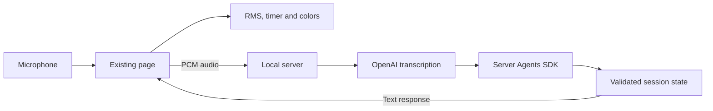

# SpeakerCoach server POC

Read the [visual solution guide](docs/README.md) for the introduction, architecture, module details and code navigation.

The current task preserves the existing browser's microphone meter, speaking timer and colors, and adds visible replies from an OpenAI agent running in the local server.
This is the first demonstration within Sprint 0. Full benchmark replay isolation, speaker identification and product acceptance remain separate work.

The server owns the API key. The page receives transcript and agent results, never credentials.
The original benchmark transcript and timestamps are not inputs to the live agent and remain unchanged.

## Run

Requires Node.js 22+ and the dependencies in `poc/package.json` (`cd poc && pnpm install --ignore-scripts` on a fresh checkout).
The confirmed credential lives in `poc/.env.local`, which is ignored by Git. Its names and optional overrides are documented in `.env.example`.
From the repository root, run `bash poc/start.sh`, then open http://127.0.0.1:3000.
Press **Start Listening**, allow microphone access, and wait for **listening on server** before speaking.
The original level, speaking indicator, duration and GOOD/LAND IT/STOP colors continue locally. The lower panel shows server audio counts, transcript and actual agent reply.
Press **Stop listening** to release the microphone and connections. Restart explicitly after a server error. The last answer stays visible with stopped/degraded status.
Microphone audio and selected transcript text are sent to OpenAI while listening. This is a local single-session POC with no persistent conversation storage.

## Verification and limits

`node --test poc/poc.test.mjs` runs deterministic checks. [Browser smoke](browser-smoke.md) exercises the actual cloud path with synthetic speech.
[Observed results](RESULTS.md) separate tested behavior from remaining Sprint 0 acceptance work.
This increment does not implement isolated benchmark replay, speaker identification, P-toggle interpretation, automatic reconnection or production deployment.
