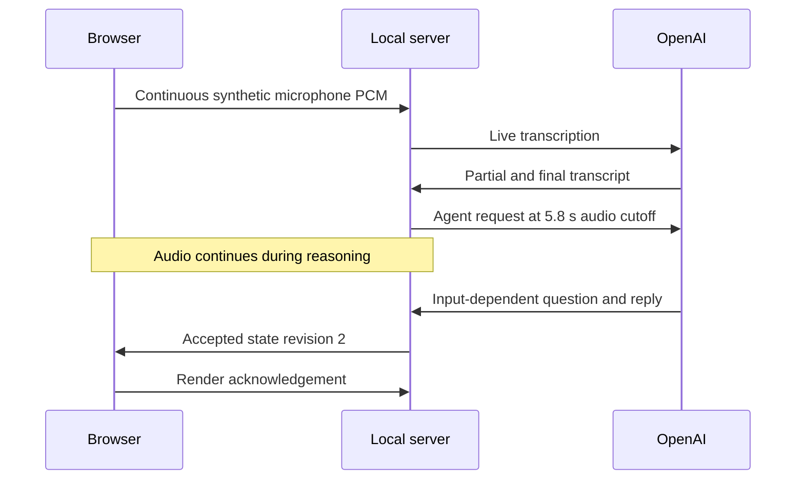

# Browser-to-server proof observed

On 26 October 2026 UTC, the POC preserved the local color/timer behavior and displayed an actual audio-dependent OpenAI Agents SDK reply in Chrome.
This satisfies the user's narrowed demonstration request. Sprint 0 remains active; its broader acceptance criteria are not all complete.

## Observed checks

| Check | Evidence |
| --- | --- |
| Deterministic tests | Eight passed: ordering, controller validation, question retention, transcript reconciliation, concurrency, cancellation, resampling and HTTP/WS boundaries |
| Real OpenAI startup | Model returned “The server-side agent is ready.” through the local WebSocket |
| Real audio path | Synthetic speech entered Chrome's microphone, crossed the worklet and local server, and produced a cloud transcript |
| Visible agent output | Page showed “The question asks about your experience building distributed systems.” with the matching retained question |
| Intake during inference | Accepted request started at packet 58; packet 72 had arrived by completion |
| Local feedback | Microphone remained listening; controlled 26/36/0-second inputs produced gold LAND IT, red STOP and green GOOD |
| Stop | Browser tracks ended, AudioContext closed and server session count returned to zero; no page JavaScript errors |
| Visual inspection | Inspected the 1280×900 browser screenshot; original green panel, meter, controls and readable server text were visible |

The accepted audio request started at Unix ms 1792983212006 and completed at 1792983213488 (1482 ms). Browser render acknowledgement reached the server at 1792983213510 (22 ms later).
These are server wall-clock timings for one synthetic trial, not benchmark latency or an independently measured paint time.
A prior partial-transcript proposal was rejected after its evidence changed. The next final-transcript proposal was accepted.
The first browser trial used an accidentally silent synthetic file; it verified intake and startup response only. After regenerating audible speech, the full browser smoke passed.

## Reproduce and remaining scope

Use the [run instructions](README.md), [deterministic test guide](poc.test.md), and [live browser smoke guide](browser-smoke.md). Synthetic speech was generated with macOS `say` and converted to mono 48 kHz PCM WAV with three seconds of silence appended.
The screenshot is disposable at `/tmp/speakercoach-poc-browser.png`; [technical evidence](evidence.json) retains timestamps and source hashes.
Physical microphone behavior, human usability, speaker identification, P hints, isolated progressive benchmark replay and benchmark accuracy remain unverified or unimplemented.
The live smoke is not an isolated benchmark replay. It does not establish the full Stage 04 protocol or all Sprint 0 acceptance criteria.
The original benchmark files and sprint state are unchanged. No commit, push, sprint close or documentation approval was performed.
