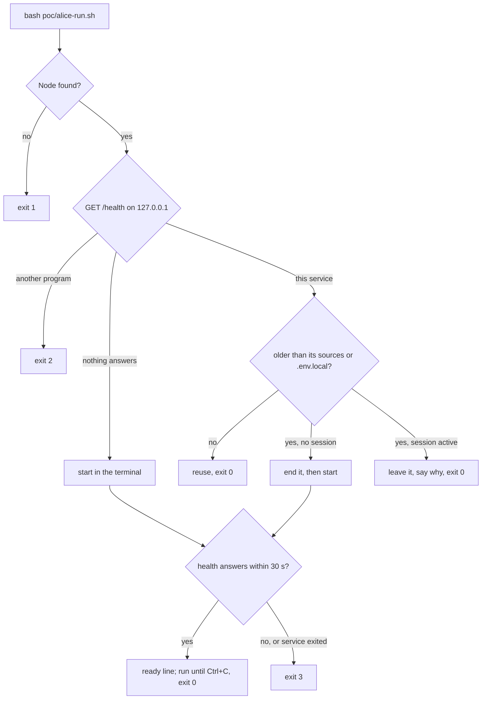

# `poc/alice-run.sh`: start or reuse Alice's service

[Source: alice-run.sh](alice-run.sh) · related: [start.sh](start.md)

One command gets Alice ready: it starts the local service, or reuses one already running, without interrupting a session or printing the key.



*No OpenAI request is made and nothing from `.env.local` or the package is printed.*

| Interface | Contract |
| --- | --- |
| Arguments | None. An argument prints a usage line and exits 64. |
| Environment | `ALICE_GOOD_MEETINGS_NODE` (Node path), `PORT`. Other settings, including `ALICE_PRINT_REQUEST`, are left as found. |
| Port | `PORT`, else the `PORT=` line of `poc/.env.local` (no other line is read), else 3000; outside 1 to 65535 exits 64. |
| Exit codes | 0 started and ended by Ctrl+C, reused, or left running during a session; 1 no Node; 2 another program on the port; 3 older service would not end, service exited or did not answer in 30 seconds; 64 bad arguments or port. |

The probe uses Node with a 2-second limit; a silent listener or a reply that is not this service's counts as another program. A service is older when `server.mjs`, `agent.mjs`, `session.mjs`, `answer.mjs`, `answer-area.mjs`, `package-loader.mjs`, `package-store.mjs`, `meeting-log.mjs`, `vocabulary.mjs` or `.env.local` changed after `startedAt` in `/health`. An older idle service is found by its listening port (`lsof`), sent SIGTERM and waited for up to 5 seconds. `--env-file=.env.local` is passed only when that file exists; otherwise the script says recognition and proposed answers are unavailable. It does not open the page. The script never sources the env file.
Collaborators: [server](server.md) provides `/health` and shutdown; run it from the repository root.

```bash
bash poc/alice-run.sh
```
