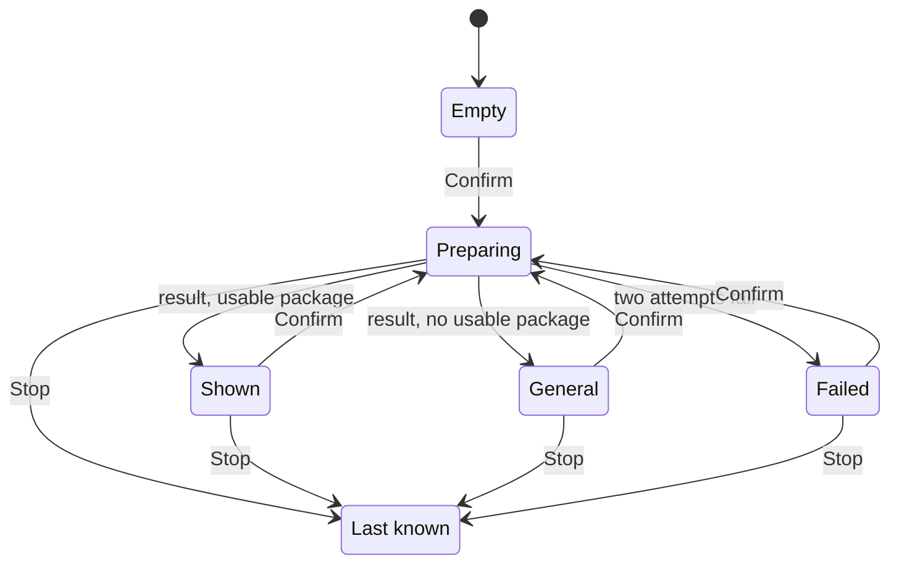

# Proposed-answer area of one session

[Source: answer-area.mjs](answer-area.mjs) · owned by [InterviewSession](session.md)

The answer area decides what the page may show as the proposed answer and keeps it attached to the right Focus question. It is kept apart from the session `state`: it is never in reasoning snapshots, in cached `question.result` states or in `revision`.

*Unavailable is a page state before any session exists, so it is not a status here.*

| Interface | Contract |
| --- | --- |
| `new AnswerArea({sessionId, generate, publish, audit?, now?, timeoutMs?, print?, focusVersion})` | Without `generate` the area stays `empty` (older callers). `now` is the clock for timing; `focusVersion()` reads the session's current version. |
| `begin(question, version)` | Called by Confirm: aborts and supersedes the earlier request, sets `preparing` with no content, records `t0` and starts one request. Never more than one in flight. |
| `view()` / `seq` | A copy of `{status, focusVersion, bullets, details, reason, lastKnown, lastStatus}` and the publication sequence, which rises with every change. |
| `setPackage(pkg)` | Holds the package read once at session start. |
| `voiced()` / `rendered({answerFocusVersion, answerStatus})` | Record the speech-start time `tS` and the render time `t3`. |
| `stop()` | Aborts, writes the timing event and turns `shown`, `general`, `failed` or `preparing` into `last-known`, keeping content and the earlier status in `lastStatus`. |

Each attempt runs `generate(request, {signal})` with the attempt timeout; a failed attempt (throw, timeout, rejected result) is retried once at once with the same request object, invisibly. A result is accepted only while the session is active and the request is current; otherwise it is dropped and audited as `stale-version`, `stopped` or `superseded`. An accepted result is published as one `proposed` message `{proposed, proposedSeq}`.
Audit events never hold text: `answer_requested`, `answer_accepted`, `answer_dropped`, `answer_failed` and one `answer_timing` per Focus version with `t0` to `t3`, `tS`, `delayMs`, `generationMs`, `pauseMs` and `visibleBeforeSpeech`. Times come from the injected clock.
Collaborators: [answer](answer.md) builds the request and checks results; [package loader](package-loader.md) supplies documents.
