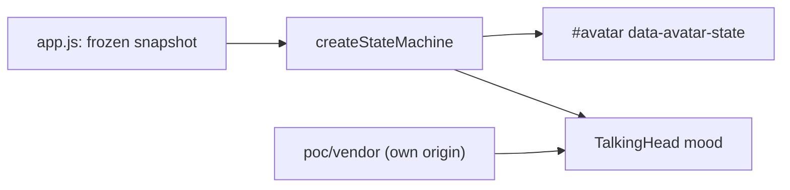

# The small avatar of Alice

[Source: avatar.js](avatar.js)

A round face in the left of the bar that shows, in a glance, what Alice is doing: idle, listening, a question, researching, ready or an error. It is decorative (`aria-hidden`), makes no sound and no speech, and is the one place on the screen that may move (SA-16). Rules AV-1 to AV-8 of [08](../docs/asdg/08-low-level-design/03.7.9-s004-avatar.md).

## Responsibilities and collaborators

Owns the avatar's state machine and the drawing of one face. It reads a snapshot and nothing else, and has no write path to the cue, timer, audio, service or log.

- [app](../app.md): loads this module with `import('/poc/avatar.js')` after the page is ready, freezes the snapshot and wraps every call in try/catch; any failure within 5 seconds, or reduced motion, removes the box and the toggle silently.
- [server](server.md): serves this file and the fixed list of vendored files (`VENDOR_ASSETS`), nothing else from `poc/vendor`.
- [vendor](vendor/VENDOR.md): TalkingHead v1.8.2, three 0.187.0 and the CC0 model `mpfb.glb`, pinned with SHA-256 hashes and their licences beside them.

## Interface and data

| Callable or interface | Contract |
| --- | --- |
| `createStateMachine(now?)` | Returns `{update(snapshot)}`; the snapshot is `{listening, candidate, focusVersion, answerStatus, errorCause}`. Returns `idle`, `listening`, `question`, `researching`, `ready` or `error`. `question` starts when a candidate appears or the Focus version rises and lasts 1.5 s; `ready` starts when an answer is shown and lasts 2.5 s; a failed answer shows `error` for 3 s; a timed state cannot start within 3 s of the last timed start. Priority: error, researching, question or ready, listening, idle. `now` is the page clock. |
| `MOODS`, `TIMES`, `FPS` | The mood of each state (neutral, neutral, love, neutral, happy, sad), the times above in milliseconds, and the 15 frames a second cap given to the library (`modelFPS`). |
| `createAvatar({box, base?, now?})` | Imports TalkingHead from `base` (default `/poc/vendor/`), shows `models/mpfb.glb`, counts draws in `box.dataset.avatarFrames`, and returns `{update(snapshot), setActive(on), dispose()}`. It throws on any failure (no WebGL, file missing, load error); the page then drops the avatar. It stops drawing while the tab is hidden. |

## Effects and failure behavior

Head movement is off (`avatarIdleHeadMove` 0) and there are no gestures; the library has no nod, so a change of state is shown only by a change of mood. `researching` and `listening` use the same neutral mood as `idle`, because the library's built-in moods are only neutral, happy, angry, sad, fear, disgust, love and sleep; the state still shows in `data-avatar-state`. The library draws only while running; it is stopped when the avatar is off or the tab is hidden. Draco decoding is off, so nothing is fetched from a CDN. The speech and streaming parts of the library are never used.

Checked: the state machine by `poc/poc.test.mjs`, and the face in the built-in browser. Not checked: the 15 frames a second cap (the pane's animation frames are throttled), load on a laptop during a call, and the real load time within 5 seconds.
