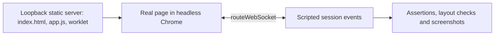

# Deterministic browser protocol check

[browser-protocol.mjs](browser-protocol.mjs) drives the real page in headless Chrome against a scripted `/session` WebSocket. It checks the UC-04 question controls without the POC service, transcription or OpenAI, so it costs nothing to run.



Run it from the project root with Node.js 22+ and an installed Playwright and Chrome:

```bash
PLAYWRIGHT_MODULE=/path/to/playwright/index.mjs CHROME_PATH="/Applications/Google Chrome.app/Contents/MacOS/Google Chrome" node poc/browser-protocol.mjs
```

| Helper | Responsibility |
| --- | --- |
| Static `assets` server | Serves the three public files on an ephemeral loopback port; Playwright routing does not see AudioWorklet module loads |
| `routeWebSocket` handler | Records each page socket's controls and `rendered` acknowledgements; never connects anywhere |
| `emit(socket, type, data, sessionId?)` | Sends a server event; a different `sessionId` simulates a stale session |
| `state(revision, changes)` / `live(id, version, text, kind)` | Build server state and Live objects |
| `page.clock` | Fake page time: advances the 5-second uncertainty timer and animation frames on demand |

The cases are: empty Focus and Live with the right hints until and after `ready`; a heard question filling Live with its tag; keyboard confirmation sending the displayed Live; a newer Live during a pending request; a stale result; a lost acknowledgement becoming uncertain and retried identically; Focus set only by the confirmed result, with older and other-session events rejected; the 4 November case, where a new question fills Live while Focus stays; Live matching Focus; Clear live; disconnect while pending, with Live showing "Not listening"; and restart with empty memory and nothing replayed.
`checkLayout(name)` measures each [panel state](../docs/asdg/08-low-level-design/03.1-uc-04-panel-states.md) (ready, heard, uncertain, confirmed, answering at LAND IT, new question, long Live, disconnected) at 1280 × 900 and 390 × 844: no horizontal overflow and no overlap with the other panels.
Stdout is a JSON result; any failed assertion or page error exits non-zero. Screenshots go to `/tmp/speakercoach-uc04-<state>-<width>.png`.
The scripted events prove the page's protocol handling and layout only. They do not show recognition quality, real timing or usability; the [live smoke](browser-smoke.md) covers the real service.
