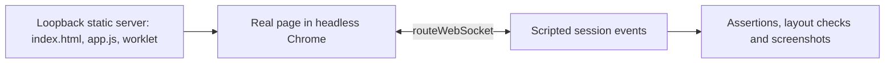
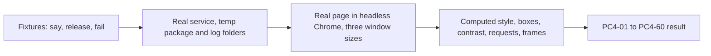

# Deterministic browser protocol check

[browser-protocol.mjs](browser-protocol.mjs) drives the real page in headless Chrome against a scripted `/session` WebSocket. It checks the UC-04 question controls without the POC service, transcription or OpenAI, so it costs nothing to run.



Run it from the project root with Node.js 22+ and an installed Playwright and Chrome:

```bash
PLAYWRIGHT_MODULE=/path/to/playwright/index.mjs CHROME_PATH="/Applications/Google Chrome.app/Contents/MacOS/Google Chrome" node poc/browser-protocol.mjs
```

| Helper | Responsibility |
| --- | --- |
| Static `assets` server | Serves the three public files on an ephemeral loopback port; Playwright routing does not see AudioWorklet module loads |
| `routeWebSocket` handler | Records each page socket's controls and `rendered` acknowledgements; never connects anywhere |
| `emit(socket, type, data, sessionId?)` | Sends a server event; a different `sessionId` simulates a stale session |
| `state(revision, changes)` / `live(id, version, text, kind)` | Build server state and Live objects |
| `page.clock` | Fake page time: advances the 5-second uncertainty timer and animation frames on demand |

The cases are: empty Focus and Live with the right hints until and after `ready`; a heard question filling Live with its tag; keyboard confirmation sending the displayed Live; a newer Live during a pending request; a stale result; a lost acknowledgement becoming uncertain and retried identically; Focus set only by the confirmed result, with older and other-session events rejected; the 4 November case, where a new question fills Live while Focus stays; Live matching Focus; Clear live; disconnect while pending, with Live showing "Not listening"; and restart with empty memory and nothing replayed.
`checkLayout(name)` measures each [panel state](../docs/asdg/08-low-level-design/03.1-uc-04-panel-states.md) (ready, heard, uncertain, confirmed, answering at LAND IT, new question, long candidate, disconnected) at 1280 × 900 and 390 × 844: no horizontal overflow and no overlap with the other panels.
Stdout is two JSON results (the UC-04 protocol, then the SPRINT-004 page check); any failed assertion or page error exits non-zero. Screenshots go to `SCREENSHOT_DIR` (default the system temporary folder): `alice.good.meetings-uc04-<state>-<width>.png` and `page-<state>-<size>.png`.
The scripted events prove the page's protocol handling and layout only. They do not show recognition quality, real timing or usability; the [live smoke](browser-smoke.md) covers the real service.

## SPRINT-004 page check (PC4-01 to PC4-60)

After the UC-04 protocol, `sprint004Checks` drives the real page against the real service (`createPocServer`) with the [fixtures](fixtures.md): a held generator, scripted transcription, a synthetic package and a temporary log folder, no OpenAI and no key beyond a fake value. The rules and cases are 08's ([03.8.2](../docs/asdg/08-low-level-design/03.8.2-s004-page-checks-screen.md), [03.8.3](../docs/asdg/08-low-level-design/03.8.3-s004-page-checks-behavior.md), [03.8.6](../docs/asdg/08-low-level-design/03.8.6-s004-avatar-checks.md)); each case keeps its ID and reports PASS, FAIL (with the first lines of the reason) or NOT RUN.



*The microphone is one synthetic tone (`FAKE_MIC`), so the service never sees a pause: `service()` turns the pause rule and automatic Focus off, and PC4-31 turns Focus back on. Set `PC_PROGRESS=1` to print each case as it finishes.*

| Helper | Responsibility |
| --- | --- |
| `service(options)` | A fresh service with a temporary package folder and a temporary `logDir` (the default `poc/logs/` is never used) |
| `reach(browser, state, options)` / `withState` | A fresh service and page in `idle`, `listening`, `candidate`, `preparing`, `shown`, `failed` or `last-known`; `withState` also reports page errors and, with `PC_PROGRESS`, the visible state of a failed case |
| `textFacts` (run in the page) | Every visible text with its computed weight, size and effective contrast, used by the bold, contrast and wording cases |
| `page.clock` | Controls the page clock for the 10-second hold (PC4-46), the pause notice (PC4-18) and the avatar timing (PC4-52) |

Window sizes are 1280 × 900, 1280 × 500 (short), 390 × 844 and 1280 × 1200. Playwright is a dev dependency of `poc/` (see `package.json`, exact version, installed with scripts off and no browser download); `CHROME_PATH` points at an installed Chrome. A run takes about two minutes.

What it does not show: the real microphone, recognition, OpenAI, the live feel of the avatar, and the app on a real second monitor. PC4-52 checks the avatar's timing on the page's own clock; the full timing and priority rules are checked on the state machine in `poc.test.mjs`.

## Additions after the review of 21 November 2026

The first run of these checks drove Confirm by hand, so the automatic flow was not covered. Added: PC4-20 also runs with automatic Focus and expects the candidate area cleared with Space and Esc sending nothing; PC4-12 sends an empty item and expects the words to stay; PC4-22 refuses the microphone for real and shows a service error that has no wording of its own; PC4-24 expects the words to stay after Stop; PC4-18 expects the pause notice only after 4 seconds and not while the reader works. The UC-04 part expects a reading equal to the Question to show no candidate.
