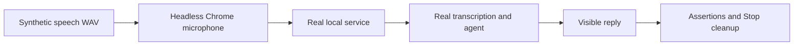

# Live browser smoke check

[browser-smoke.mjs](browser-smoke.mjs) checks the whole page using a synthetic WAV microphone and the running local service.

Run `node poc/browser-smoke.mjs /absolute/path/to/synthetic.wav` with the server already running. This deliberately makes billable OpenAI requests; it does not send a private benchmark recording.
`PLAYWRIGHT_MODULE` optionally supplies an installed Playwright module path; `CHROME_PATH` selects an installed browser executable. `POC_URL` defaults to `http://127.0.0.1:3000`.
The script uses an isolated browser profile, microphone permission and Chromium's fake-audio flags. It never reads the API key.
It waits up to 60 seconds for an answer citing an audio cutoff above zero, checks that the same reply is in the page, and checks local microphone status.
It exercises the 25/35-second color decisions by controlled timer inputs; this is not a real 36-second speaking test.
Stop must end tracks, close the AudioContext and leave zero server sessions. JavaScript page errors fail the check.
Stdout is a JSON result. A screenshot is saved to `/tmp/speakercoach-poc-browser.png`; this disposable evidence is not committed.
This test does not establish physical microphone capture, human usability, speaker identification or benchmark accuracy.
It does not exercise the UC-04 question controls; [browser-protocol.mjs](browser-protocol.md) checks those deterministically without OpenAI.
