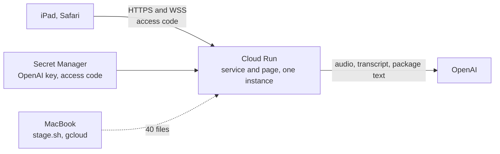

# Running Alice on Google Cloud Run

Pablo wants to try Alice on his iPad over HTTPS, without the MacBook running. The page needs a service that holds the OpenAI key and carries the audio over a WebSocket, so a static host is not enough: the same local service and page run in one container on Google Cloud Run. This folder holds what that needs. Nothing here deploys anything; the [commands](commands.md) are Pablo's to run, after he approves.

*The MacBook only prepares and publishes; the iPad then talks to Cloud Run directly.*

## What changes when it is hosted

All four settings are off on a local service, which behaves exactly as before.

| Setting | Effect |
| --- | --- |
| `ALICE_PUBLIC_HOST` | The published host name (several, comma-separated). The service then listens on all interfaces, accepts that Host over https only, and takes `https://<host>` as the page's origin. Local addresses still work. |
| `ALICE_ACCESS_CODE` | The package, the log and the session need the code: a header on requests, a subprotocol header on the WebSocket, compared in constant time. The page asks for it once and keeps it for the tab. |
| `ALICE_LOG=off` | No meeting log is written and Download log says "No meeting log yet." It works only together with `ALICE_PUBLIC_HOST`; a local service always logs. |
| `ALICE_AVATAR=off` | The avatar's files are not served, so the page drops the avatar silently. Recommended for the 2015 iPad. |

## What is published

`stage.sh` copies only the paths in [publish-files.txt](publish-files.txt) into `poc/deploy/.stage` (ignored by Git) and prints them: the page, nine service modules, the audio worklet, the avatar adapter, the vendored avatar files, the package manifest and lockfile, the `Dockerfile` and `.dockerignore`. That is 40 files and 38 MB, of which the avatar model is 37 MB. Never published: `poc/.env.local`, `poc/context/`, `poc/logs/`, tests and fixtures, `docs/`, `asdg/`, `openspec/`, `eval-data/`. A test checks the list against what the service imports.

## What protects it, and what does not

- **The key never passes through a file or a chat.** It goes from `poc/.env.local` straight into Secret Manager by a command Pablo runs, and Cloud Run hands it to the container.
- **Without the code nobody can start a session**, so nobody else can spend on the OpenAI key. The page itself, `/health` and the avatar files can be loaded by anyone who has the address.
- **The code is as strong as Pablo makes it.** Wrong tries are not counted or slowed. Use at least 16 characters.
- **The code is not in any address.** Cloud Run records request addresses in its own logs; headers are not recorded.
- **Cloud Run's logs receive the service's audit lines**: session ids, counts and timings. They hold no speech, no package text and no code. `ALICE_PRINT_REQUEST` must never be set on a hosted service.
- **One session at a time, 30 minutes at most**, as on the MacBook.
- **An uploaded package lives in the instance's memory.** Cloud Run stops an idle instance after some minutes, and the package is gone; upload it shortly before use.

## Status

Written on 22 November 2026. Not deployed. The hosted settings are covered by `poc/poc.test.mjs`, and the staged copy was started in-process on a loopback address. The `Dockerfile` was not built and no `gcloud` command was run: neither tool is installed here. The rule that every session writes a log (ML-13) is not yet amended for `ALICE_LOG=off`; that is 08's page. Return to the [POC README](../README.md).
