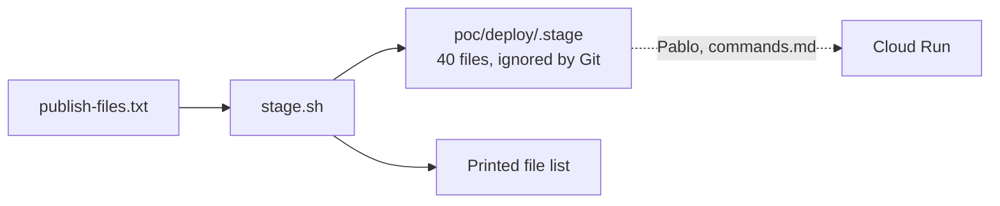

# Staging the files to publish

[Source: stage.sh](stage.sh)

Copies exactly the files named in [publish-files.txt](publish-files.txt) into `poc/deploy/.stage`, adds the `Dockerfile` and `.dockerignore`, and prints the resulting list. The stage is what `gcloud run deploy --source` uploads, so nothing outside the list can leave the Mac. It uploads and deploys nothing itself.

## Interface

| Callable or interface | Contract |
| --- | --- |
| `bash poc/deploy/stage.sh` | Takes no arguments and runs from any folder. Empties and refills `poc/deploy/.stage`, prints one path per line, then a line with the count and size. |
| `publish-files.txt` | One path per line from the repository root; `#` starts a comment; a folder is copied whole. An absolute path or one holding `..` stops the script with status 64. |
| `Dockerfile` | `node:22-slim`; production dependencies from the frozen lockfile with install scripts off, by pnpm 12.21.0 through corepack; runs as user `node`; starts `node poc/server.mjs`. Secrets and settings come from Cloud Run, never from the image. |
| `.dockerignore` | A second guard inside the stage against `.env*`, logs, `context` and `node_modules`. |

## Effects and failure behavior

A listed path that does not exist stops the script with status 1 and no usable stage. After copying, the script searches the stage for `.env*`, `*.jsonl`, `node_modules`, `context/`, `logs/` and `*.test.mjs`; if any is found it names them and exits 1. The stage is deleted and rebuilt on every run, so it never holds a file from an earlier list.

## Example

`bash poc/deploy/stage.sh` ends with `Staged 40 files, 38M, in poc/deploy/.stage`. The [commands](commands.md) use that folder as the deploy source.
