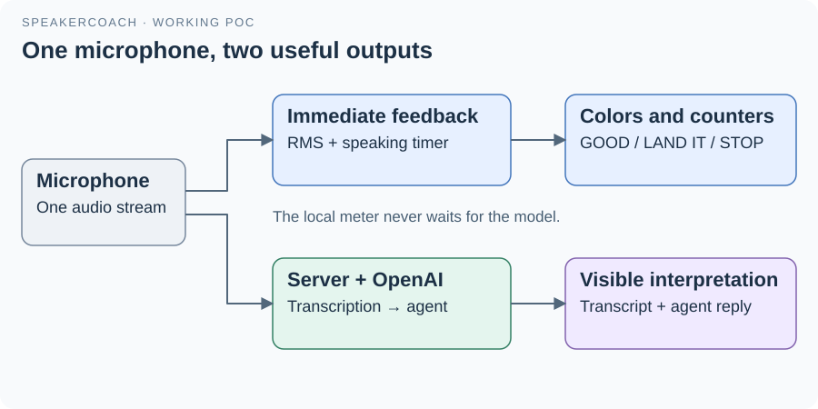

# 01 · What the POC demonstrates

SpeakerCoach now demonstrates a complete audio-to-agent round trip while preserving the original speaking-duration feedback.
The page continues listening, showing sound level, tracking the current speaking turn and changing between GOOD, LAND IT and STOP.
A second path sends that microphone audio to a local Node.js service, which uses OpenAI transcription and an OpenAI Agents SDK agent.

## What you see

The upper diagnostic panel reports local microphone status, speaking activity, elapsed time and level.
The lower panel reports the server connection, received audio count, transcript, retained question and latest agent reply.
An initial model-generated readiness reply proves that reasoning is connected. An audio-dependent reply proves that speech has reached the model path.
Neither a green panel nor a successful health response alone establishes that cloud transcription and reasoning work.

## Why the pieces are separate

Local colors depend on measured sound and time, so they can react without waiting for a network request.
The server owns transcription transport, session state and the API credential; the browser renders the results.
Model output proposes an interpretation. Application code decides which proposal becomes accepted state.
The agent runs within the application through the Agents SDK; model inference and transcription run in OpenAI's cloud.

## What has been demonstrated

The recorded browser trial delivered synthetic speech, displayed its transcript and showed: “The question asks about your experience building distributed systems.”
It also checked the color thresholds and Stop cleanup. The user subsequently reported that the running POC worked.
See [recorded evidence and its limits](07-running-and-verification.md); this does not establish benchmark accuracy or every interview scenario.

Speaker recognition, P-toggle hints, isolated benchmark replay and production operation remain outside this implemented slice.
The broader [intended architecture](../../docs/asdg/05-high-level-design-and-architecture/01-architecture.md) describes capabilities beyond this proof.

[Guide](README.md) · [Next: architecture](02-architecture.md)
